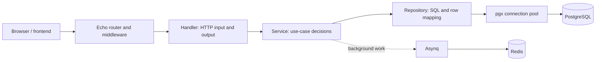

# Learning the Tasker Backend

This guide follows the Tasker application from startup to authenticated feature
requests, database queries, attachments and background work. Start here before
reading individual files.

Updated against source on 2026-10-25. Code links are the reference if the project
changes later. Documentation does not certify runtime behavior or production readiness.

## Recommended Reading Order

| Order | Guide | Question it answers |
| --- | --- | --- |
| 1 | This page | What is the whole system, and where am I in the feature? |
| 2 | [go-reading-basics.md](go-reading-basics.md) | What do pointers, receivers, tags, generics, constructors, and contexts mean? |
| 3 | [../internal/server/README.md](../internal/server/README.md) | What happens when `task run` starts the backend? |
| 4 | [../internal/model/README.md](../internal/model/README.md) | How are database rows, Go models, and request DTOs different? |
| 5 | [../internal/repository/README.md](../internal/repository/README.md) | How does one CRUD method work, and what changes for lists/joins? |
| 6 | [../internal/service/README.md](../internal/service/README.md) | What does a feature service decide? |
| 7 | [../internal/handler/README.md](../internal/handler/README.md) and [../internal/router/README.md](../internal/router/README.md) | How does the operation become an HTTP endpoint? |
| 8 | [building-a-feature.md](building-a-feature.md) | In what order should I implement and verify one complete feature? |
| 9 | [local-development.md](local-development.md) | How do I run, inspect, and troubleshoot it safely? |

Use the supporting folder guides below when you encounter their code. You do not need to learn every logging or email helper before understanding Category creation.

## 1. The Mental Model

The backend is a Go program. Echo handles HTTP. PostgreSQL stores relational data. Redis supports background jobs. Your models describe data; repositories send SQL; services coordinate use cases; handlers translate HTTP requests and responses.

The synchronous route through these layers is implemented. Background work has
a separate entry path; not every service operation enqueues a job.

## 2. Start With What Already Runs

Read [../cmd/tasker/main.go](../cmd/tasker/main.go) from top to bottom:

1. Load configuration.
2. Construct logging and optional New Relic integration.
3. Run database migrations only when the environment is not `local`.
4. Construct the shared server resources.
5. Construct repositories, then services, then handlers.
6. Construct the router and attach the HTTP server.
7. Listen for requests until an interrupt triggers shutdown.

`New...` functions are ordinary Go functions. Nothing here automatically discovers your features because you created a file.

## 3. Current Feature Boundary

In [../internal/service/services.go](../internal/service/services.go), startup
constructs Auth, Todo, Category and Comment services and exposes Job. Follow
that registry into `NewHandlers` and the versioned router to see the complete wiring.

| Part | Current state |
| --- | --- |
| Boilerplate startup | Config, logging, DB pool, Redis client, worker, and HTTP server are constructed |
| Database schema | Three migrations define helpers, categories, todos, comments, attachments and indexes; applied state is separate |
| Models/DTOs | Feature types exist; validation caveats are documented in the model guide |
| Repositories | Todo, Category, and Comment methods exist and are registered; Todo query caveats remain |
| Feature services | Todo, Category and Comment coordinate operations and ownership checks |
| Feature handlers/routes | CRUD, statistics, comments and attachments registered under `/api/v1` |
| Authentication | Clerk middleware protects the feature route groups |
| Background work | Asynq worker starts with the server; scheduling uses a separate cron executable |
| Frontend | React pages, forms, typed API hooks, auth and theme providers are present |
| Tests/deployment | Test helpers exist; comprehensive feature coverage and deployment remain later work |

When learning a feature, ask these questions in order:

1. What data does it accept and return?
2. What SQL changes or reads that data?
3. What business and ownership checks must happen?
4. What handler binds and validates the request?
5. What route exposes that handler?
6. What test proves the whole path works?

## 4. How to Use These Docs

The folder guides explain shared concepts once and link to actual code. Examples marked **planned** or **illustrative** are not implemented endpoints. Existing code can also contain mistakes; a later walkthrough will distinguish intended behavior from those limitations.

Keep application secrets out of documentation and screenshots. Reading or starting the backend is not the same as testing every query, authentication path, or external integration.

## 5. Why So Many Folders?

The boilerplate separates responsibilities so an HTTP concern, a business rule, and a SQL query do not all accumulate in one function. This is a practical layered project, not perfectly isolated clean architecture: shared server dependencies are passed broadly, and some rules/errors still live in repositories.

Models are data types passed between layers, not a network hop after the repository. The same Go process calls these packages; they are not separate microservices.

| Folder guide | What it owns |
| --- | --- |
| [../internal/config/README.md](../internal/config/README.md) | Environment decoding, validation, defaults, and actual consumers |
| [../internal/server/README.md](../internal/server/README.md) | Shared resources, startup, HTTP listener, shutdown |
| [../internal/database/README.md](../internal/database/README.md) | Pool/tracer construction and migration execution |
| [../internal/model/README.md](../internal/model/README.md) | Shared fields, feature types, DTOs, optional inputs |
| [../internal/repository/README.md](../internal/repository/README.md) | Parameterized SQL, mapping, filters, ownership predicates |
| [../internal/service/README.md](../internal/service/README.md) | Current service wiring and use-case decisions |
| [../internal/handler/README.md](../internal/handler/README.md) | HTTP binding, responses, generic handler helpers |
| [../internal/router/README.md](../internal/router/README.md) | Actual routes and middleware registration |
| [../internal/middleware/README.md](../internal/middleware/README.md) | Authentication hooks, context, logging, request wrappers |
| [../internal/validation/README.md](../internal/validation/README.md) | Shared bind/validate mechanics and field errors |
| [../internal/errs/README.md](../internal/errs/README.md) | Application errors and the HTTP error journey |
| [../internal/sqlerr/README.md](../internal/sqlerr/README.md) | PostgreSQL error-code translation |
| [../internal/logger/README.md](../internal/logger/README.md) | Zerolog and optional New Relic integration |
| [../internal/lib/README.md](../internal/lib/README.md) | Job/email helpers and their individual file roles |
| [../internal/cron/README.md](../internal/cron/README.md) | Periodic command execution, batching and queued email work |
| [../internal/testing/README.md](../internal/testing/README.md) | Disposable DB setup, test server, assertions, transaction helpers |

Each guide maps its source files. Closely related tiny files share one explanation rather than receiving repeated CRUD/constructor descriptions. General SQL lessons live in [../../../docs/database/README.md](../../../docs/database/README.md).

## 6. Files Outside internal

| File/location | Meaning |
| --- | --- |
| [../cmd/tasker/main.go](../cmd/tasker/main.go) | Executable entry point; manually wires the application |
| [../cmd/cron/main.go](../cmd/cron/main.go) | Separate periodic-job executable |
| [../go.mod](../go.mod) and [../go.sum](../go.sum) | Go module dependencies and checksums |
| [../Taskfile.yml](../Taskfile.yml) | Developer command aliases, not the background-task queue |
| [../.env.sample](../.env.sample) | Configuration template; local secrets belong in an ignored environment file |
| [../.gitignore](../.gitignore) | Files Git should ignore |
| [../.golangci.yml](../.golangci.yml) | Linter configuration, not automatic lint execution |
| [../static/openapi.html](../static/openapi.html) | API documentation UI returned by `/docs` |
| [../static/openapi.json](../static/openapi.json) | API specification artifact, not route registration |
| [../templates/emails/welcome.html](../templates/emails/welcome.html) | HTML artifact read by the Go email renderer |
| [../../../docker-compose.yml](../../../docker-compose.yml) | External PostgreSQL/Redis services, port publishing, and volumes |

## 7. Frontend Context, Only What You Need Now

[../../frontend/src/main.tsx](../../frontend/src/main.tsx) installs providers;
[../../frontend/src/router.tsx](../../frontend/src/router.tsx) maps URLs to
pages. The API hook in [../../frontend/src/api/index.ts](../../frontend/src/api/index.ts)
obtains a Clerk token and sends Axios requests using shared TypeScript contracts.
Read the [frontend guide](../../../docs/frontend/README.md) alongside this one.

The hook builds `${env.VITE_API_URL}/api${path}`. Feature contracts include `/v1`,
which yields `/api/v1/...`. The health contract instead uses `/status`, producing
`/api/status` through this adapter while Go registers `/status`. Use the system
route directly for health checks; the current Vite config has no proxy rewrite.

Contracts/types are useful but do not automatically typecheck raw Go SQL, generate Go endpoints, or enforce matching response shapes. Verify both sides of the HTTP boundary. Never put backend secrets into browser configuration.

## 8. Similar Words With Different Meanings

| Term | Meaning here |
| --- | --- |
| Task CLI | Runs commands defined in Taskfile |
| Todo/task feature | The user's domain records in PostgreSQL |
| Asynq task | A serialized background job stored in Redis |
| HTTP handler | Responds to an incoming HTTP request |
| Job handler | Executes queued work, possibly later or after retries |
| Model | Go data representation, not a table-creation instruction |
| Migration | Ordered SQL schema change, not a normal per-request query |
| Repository | Go data-access component, not the Git repository |

Before advancing, try explaining Category creation in your own words: which values come from the client, which from authentication, which from the database, and which layer sends the final JSON?