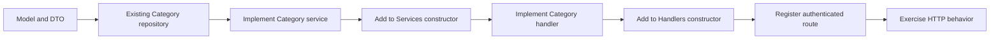

# Build One Feature From Model to HTTP

Back to [README.md](README.md). This is a learning playbook for the current project, not a claim that the example endpoint has been implemented.

## Start With One Small Complete Operation

Use **create a category** first. Its repository is smaller than a populated Todo query and teaches the same core pattern. Once the path is tested, repeat the pattern for Todo creation, then learn the extra concepts in listing, hierarchy, comments, and statistics.

Planned example: `POST /api/v1/categories`, accepting:

```json
{
  "name": "Learning",
  "color": "#22aa88",
  "description": "Backend practice"
}
```

Do not send `user_id`, an ID to assign, or server timestamps. Authentication provides ownership and PostgreSQL generates the stored identity/timestamps. This route does not exist yet.

## Step 1: Describe the Data and Invariants

Read the category table in [../internal/database/migrations/002_todos.sql](../internal/database/migrations/002_todos.sql), then [../internal/model/category/category.go](../internal/model/category/category.go) and [../internal/model/category/dto.go](../internal/model/category/dto.go).

Ask: which fields are required, which can be NULL, which are generated, and which must be unique? A DTO's limits and a database column's limits need not be identical. In this case, `(user_id, name)` uniqueness belongs to the database, not just a pre-check.

Write input-validation tests first. Verify the actual tags with realistic values, including optional description fields; do not assume every tag inherited from a tutorial is correct.

## Step 2: Verify the Existing Repository

`CreateCategory` already inserts parameterized values and maps the returned row. Use a disposable migrated database to verify the returned ID, owner, name, and timestamps. Then test duplicate names and ownership isolation in detail/update/delete methods.

Use [../internal/repository/README.md](../internal/repository/README.md) for the query mechanics. Do not test repository SQL by adding ad hoc writes to main or by inspecting only startup logs.

## Step 3: Add the Missing Use Case

The future Category service coordinates the operation and consistent error behavior. A simple create may delegate after input/identity checks; more involved operations need additional decisions. It should not build HTTP headers or duplicate SQL.

For Todo creation, this same step must verify related parent/category ownership. For comments, it must verify access to the referenced Todo. Pass the authenticated identity explicitly. Think about race conditions and database constraints as well as read-before-write checks.

The service registry currently exposes only Auth and Job. A new service must be constructed and stored there before handlers can use it. See [../internal/service/README.md](../internal/service/README.md).

## Step 4: Add the HTTP Boundary

A future handler needs to allocate a **fresh DTO per request**, bind input, run validation, retrieve authenticated identity, and call the service using the request's Go context. It returns a created response on success and lets the shared error handler format failures.

The existing generic helpers centralize much of this, but review their captured-request-pointer behavior and the validation helper's error handling before using them. Avoid sharing a mutable DTO allocated once during route registration.

## Step 5: Connect All Registries



This is implementation order, not the direction an HTTP request travels. At runtime the route calls the handler, then service, then repository.

Add the route under an explicitly authenticated group. Merely having `RequireAuth` available in a registry does not apply it. Do not trust a user ID from request JSON as a substitute.

## Step 6: Verify the Boundary Before Adding More Features

| Case | What to prove |
| --- | --- |
| Missing/invalid token | Authentication rejects the request |
| Bad JSON or invalid fields | Consistent client error, not panic or SQL execution |
| Valid create | Correct success status, JSON shape, and stored owner |
| Duplicate name for same owner | Constraint error translated consistently |
| Same name for different owner | Allowed, according to the schema |
| Detail/update/delete for another owner | No access and no unintended disclosure |
| Concurrent requests | No shared DTO state or data race |

Only after the Go path works should you add/update the frontend contract and UI call. Check method, URL prefix, authorization header, and response fields in the Network tab. A shared TypeScript type cannot register an Echo route.

## Then Extend to the More Complex Todo Cases

- A populated Todo needs joins/aggregation and tests for duplicate child/comment rows.
- A list needs validated defaults, an allowlisted sort, properly grouped search filters, stable ordering, and matching counts.
- A parent update needs ownership checks and cycle rules beyond a direct self-parent constraint.
- A partial update needs a deliberate distinction between omitted fields and explicitly clearing nullable fields.
- Multiple atomic database writes need the same transaction; calls on the ordinary pool are outside it.

The current [../internal/repository/README.md](../internal/repository/README.md) records observed SQL and ownership-filter issues. Address those before using Todo lists as a reference implementation. This documentation change intentionally leaves application fixes to feature work.

## Stop and Explain These Before Moving On

1. Why doesn't creating a model create a table?
2. Why is a repository method not callable directly from the browser?
3. Why are authentication and ownership checks different?
4. What does `%w` preserve for the error handler?
5. Why can Go compile a file whose SQL fails at runtime?
6. What test would catch one user's data appearing in another user's search?

Use the linked folder guide for the concept you cannot yet explain; do not reread every constructor just because its feature name changed.