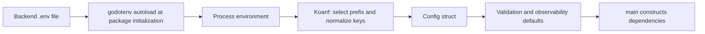

# Configuration: From Environment to Go Values

Back to [../../docs/README.md](../../docs/README.md).

| File | Responsibility |
| --- | --- |
| [config.go](config.go) | Application settings, environment loading, struct decoding, validation |
| [observability.go](observability.go) | Logging/New Relic/health-check settings, defaults, and custom validation |

## Loading Order



The blank import `_ "github.com/joho/godotenv/autoload"` runs that package's initialization. You do not call an explicit dotenv function inside `LoadConfig`. Existing process environment variables take precedence over values loaded by godotenv.

Run from the backend directory so relative dotenv, static, and template paths resolve as expected. Do not assume the process searches the whole repository for configuration.

## Follow One Value

An example setting, not a secret:

```dotenv
TASKER_DATABASE.HOST="localhost"
```

1. `env.ProviderWithValue("TASKER_", ".", ...)` selects variables with that exact prefix.
2. `TrimPrefix` removes `TASKER_`; `ToLower` turns the rest into `database.host`.
3. Koanf's `.` delimiter makes a nested `database` -> `host` setting.
4. `koanf:"database"` and `koanf:"host"` tags map it to `cfg.Database.Host`.

Underscores inside a field name stay underscores. `TASKER_DATABASE_HOST` is not equivalent to `TASKER_DATABASE.HOST` in this loader. These dotted names are accepted by dotenv but are not ordinary Bash variable identifiers, so do not `source` the file or try `export TASKER_DATABASE.HOST=...`. The old lowercase prefix is not selected by the current loader.

The loader also scans values shaped like `map[...]`, flattens them with
`parseMapString`, and applies them with `k.Set`. Ordinary dotted assignments do
not need that compatibility branch. Learn the scalar path first.

## Validation Is Not Connectivity

The validator checks required fields after decoding. Having a host string does not prove PostgreSQL is reachable, a Clerk key is valid, or Resend can deliver mail. Those are separate runtime concerns.

Although `LoadConfig` has an error return type, its current failure branches call `logger.Fatal`, which terminates the process. It does not consistently return errors for the caller to handle. Implicit dotenv autoload also does not provide a clear parse-error report here; malformed dotenv input may show up as many missing-field validation failures.

If all values appear missing, first check the working directory, dotenv syntax, and prefix. Plain headings in an environment file need `#`; every non-comment entry must be a valid assignment. Never print the whole file or config struct while diagnosing secrets.

## Important Runtime Details

- `Primary.Env` controls local behavior such as SQL logging and whether startup auto-runs migrations.
- The loader overwrites observability service name with `tasker` and its environment with `Primary.Env`.
- Observability defaults are assigned when the entire pointer is nil. This is not a general merge that fills every missing field in a partially supplied section.
- Server timeouts are integer seconds converted in the server package. Some observability fields are Go durations, such as `100ms` or `5s`.
- Redis's current consumers use the raw TCP address, such as `localhost:6379`, not a `redis://` URL parser.
- Database pool-limit/lifetime fields are declared and required, but the current database constructor does not copy them to pgxpool settings.
- Declaring health-check intervals or other options does not prove a scheduler consumes them. Follow each setting to its call site.

## Safe Configuration Practice

Use [../../.env.sample](../../.env.sample) as a template, not proof that every sample value works unchanged. Keep local credentials in your ignored environment file or a secret manager, never in Markdown examples. Rotate credentials that have been exposed in chat, logs, or source control.

The Taskfile migration DSN is a separate CLI input. The Go configuration loader does not automatically configure the external Tern executable.

## Practice

Find `CronConfig`, then the job that consumes `ReminderHours`. Explain why a
default assigned only when `Cron == nil` does not fill every zero field in a
partially supplied cron section. Do not print credentials while tracing values.