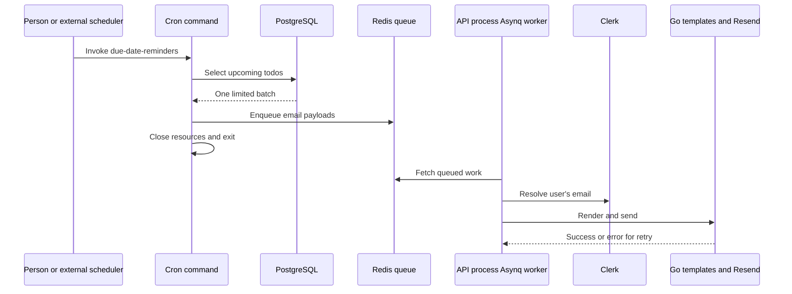

# Cron: Periodic Work Without an HTTP Request

Back to the [backend guide](../../docs/README.md). For queue processing and email
delivery, read [the library guide](../lib/README.md).

## Three Different Mechanisms

| Mechanism | Trigger | Lifetime and reliability |
| --- | --- | --- |
| Cron executable | A person or external scheduler invokes a named command | Runs once and exits |
| Asynq task | Producer serializes a task into Redis | Worker consumes it; errors can be retried |
| `go func()` | Running Go code starts a goroutine | Lives in that process; not a durable job |

There is no automatic timetable in this repository's cron registry. Starting
the API does not periodically invoke these commands. Configuring a scheduler is
future operational work.

## Files and Control Flow

| File | Role |
| --- | --- |
| [../../cmd/cron/main.go](../../cmd/cron/main.go) | Cobra CLI, `list`, and one command per job |
| [registry.go](registry.go) | Map of names to `Job` implementations |
| [base.go](base.go) | `Job` interface, dependency setup, runner and cleanup |
| [jobs.go](jobs.go) | The four periodic use cases |
| [../repository/todo.go](../repository/todo.go) | Queries used to select work and archive records |



The cron context constructs config, logging, a DB pool, Redis client, Asynq
**producer** and repositories. It builds a partial `server.Server` instead of
calling `server.New`, so it does not start an HTTP listener or worker. Its
runner uses `context.Background()` without a job-wide deadline.

## Implemented Jobs

| Command | Work | Relevant default |
| --- | --- | --- |
| `due-date-reminders` | Select upcoming todos and enqueue reminder emails | 24-hour window |
| `overdue-notifications` | Select overdue todos and enqueue notifications | Batch size 100 |
| `weekly-reports` | Gather seven-day user statistics and enqueue reports | Rolling seven-day window |
| `auto-archive` | Select old completed todos and update their status in SQL | Older than 30 days |

Defaults come from [config.go](../config/config.go), when the entire cron config
is absent. `auto-archive` updates PostgreSQL directly; it does not enqueue an
email. Selection semantics live in the repository, not in the command name.

## Inspect Before Executing

From the backend directory, these commands describe the CLI without executing
a job:

```bash
go run ./cmd/cron --help
go run ./cmd/cron list
```

Running a named job can mutate records or send real email through the worker.
Use isolated data and a controlled recipient before doing so. For example,
`go run ./cmd/cron auto-archive` is a write operation, not a preview.

## Reliability Boundaries to Understand

- Reminder/report task construction sets three maximum retries. Reminder tasks
  have 30-second timeouts; weekly reports have 60 seconds. Retries are not an
  exactly-once delivery guarantee.
- There is no sent-reminder ledger or unique task ID in these enqueue helpers.
  Repeated cron invocations can enqueue the same notification again.
- Reminder and archive selection uses one batch per invocation. A batch size is
  not proof that all eligible rows were processed.
- In reminder jobs, `MaxTodosPerUserNotification` limits titles collected for
  logging, not the enqueue loop. Do not describe it as an enforced email cap.
- Individual enqueue failures are logged and skipped; the job may return nil
  despite partial failure. Compare found and enqueued counts.
- Weekly detail-query failures substitute empty lists and continue. A sent
  report is not proof that every detail query succeeded.
- The API starts its worker before the service registry injects its auth
  service. Consuming existing reminder work during startup is a lifecycle risk
  to verify in later tests.

These observations describe source behavior; this documentation does not run
the jobs or send mail.

## Practice

Draw what happens if a worker sends an email and crashes before recording
success. Where would you store a deduplication key? Then explain why a goroutine
used for attachment cleanup has different recovery properties from this queue.