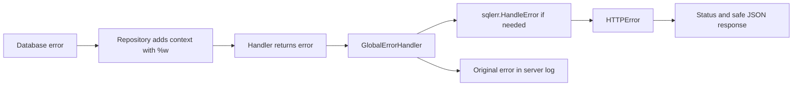

# Application Errors and HTTP Responses

Back to [../../docs/README.md](../../docs/README.md).

| File | Purpose |
| --- | --- |
| [http.go](http.go) | `HTTPError`, per-field errors, optional client actions, and helper methods |
| [types.go](types.go) | Constructors for unauthorized, forbidden, bad request, not found, and internal errors |

`HTTPError` implements Go's `error` interface through `Error() string`. It also carries structured fields for the client: `code`, `message`, `status`, `override`, `errors`, and `action`.

Constructing an error does not send an HTTP response. It is returned through the call stack until the router's global error handler writes JSON.

Services can also return a typed application error directly. Echo errors such as an unknown route are another entry point to this pipeline.

## How to Classify an Error

Use `errors.As` to obtain a typed error and inspect its status/code. Use `errors.Is` for sentinel errors such as `pgx.ErrNoRows` retained by `%w` wrapping.

The current `HTTPError.Is` implementation matches any other `*HTTPError`, not one particular status or code. Do not use it to distinguish bad request from not found.

`override`, field errors, and action fields are response metadata for a client to interpret. They do not automatically display a toast, redirect a browser, or enforce authorization.

## Why Not Expose the Original SQL Error?

Server logs need diagnostic detail; clients should receive an appropriate message without internal queries, credentials, or stack traces. The current global handler preserves the original error for logging and writes the translated response only if the response has not already been committed.

A plain `fmt.Errorf("category not found")` has no status metadata. With the current fallback translation it becomes an internal error, whereas `NewNotFoundError` or a wrapped `pgx.ErrNoRows` can become 404. This explains the importance of consistent repository/service error conventions.

Database-specific mappings are explained in [../sqlerr/README.md](../sqlerr/README.md).