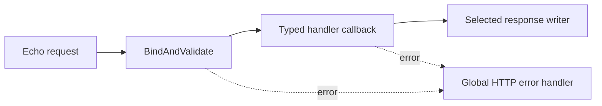

# Handlers: The HTTP Boundary

Back to [../../docs/README.md](../../docs/README.md).

A handler understands HTTP: route parameters, JSON bodies, query strings, response status, and headers. For a feature, it should bind/validate input, obtain trusted identity, call the service, and write the result. It should not duplicate repository SQL.

## What Exists

| File | Purpose |
| --- | --- |
| [handlers.go](handlers.go) | Constructs Health, OpenAPI, Todo, Category and Comment handlers |
| [health.go](health.go) | Directly checks the DB and Redis and returns JSON |
| [openapi.go](openapi.go) | Reads the local OpenAPI HTML file and returns HTML |
| [base.go](base.go) | Shared handler state and generic wrappers for JSON, no-content, and file responses |
| [todo.go](todo.go) | Todo CRUD, statistics, multipart uploads and attachment download URLs |
| [category.go](category.go) | Category CRUD and list endpoints |
| [comment.go](comment.go) | Add, list, update and delete comments |

These features are wired through the service registry and versioned routes. A
file does not register itself: follow `NewHandlers` and the router registration.

## Follow CreateTodo

`TodoHandler.CreateTodo` constructs a fresh `CreateTodoPayload` inside each
request. `Handle` binds and validates it, then invokes a typed callback. The
callback obtains `middleware.GetUserID(c)` and invokes `TodoService.CreateTodo`.
Success returns the stored Todo with HTTP 201. The body does not choose its owner.

Updates return 200; deletes use `HandleNoContent` and return 204, without JSON.
Uploads use `MultipartForm()`, reject zero or multiple entries in the `file`
field, and pass the file header to the service. The handler does not store file
bytes in PostgreSQL.

## First Example: CheckHealth

`HealthHandler` embeds `Handler`, which holds the shared server pointer. `CheckHealth(c echo.Context) error` matches Echo's handler signature.

It builds a map containing `status`, `timestamp`, `environment`, and `checks`. It pings the database and, when a client exists, Redis. `c.JSON(status, response)` serializes the Go value and writes the HTTP response.

Actual top-level status strings are `healthy` and `unhealthy`, not `UP`. Check results are nested under `checks`, not `details`.

Current limitation: database failure sets the overall `isHealthy` flag to false, but Redis failure only marks its individual check unhealthy. Therefore HTTP 200/top-level healthy does not guarantee Redis is healthy. The check uses fresh background contexts with five-second timeouts, not the request's cancellation context.

This infrastructure endpoint legitimately checks server dependencies directly; it is not the template for putting Todo business logic in a handler.

## Generic Helpers Without the Repetition

Read `Handle`, `HandleNoContent`, and `HandleFile` as variations of one process:

`HandlerFunc[Req, Res]` is a function type: it receives an Echo context and a validated request value, and returns a typed result plus an error. `Req` must satisfy `Validatable`; `Res any` allows different response types.

`handleRequest` contains the common work: timing, request-scoped logging, optional tracing, validation, callback execution, and response writing. The `ResponseHandler` interface lets JSON/no-content/file implementations supply the final response behavior without repeating that flow.

| Helper | Expected response |
| --- | --- |
| `Handle` | JSON model or response object |
| `HandleNoContent` | HTTP status with no response body |
| `HandleFile` | Byte content with filename and content-type headers |

Returning an error lets Echo invoke the configured global error handler. Avoid writing a success body and then returning an unrelated error; once the response is committed, its status/body cannot simply be replaced.

## Important Detail Before Using These Helpers

The helpers close over the supplied `req` value. Current feature methods invoke
them inside each request with a fresh DTO pointer. Preserve that pattern:
constructing a wrapper once at registration around a shared mutable pointer
would reuse input across requests and introduce races.

For another handler, the checklist is: fresh DTO, successful bind/validation/defaults, authenticated user ID, request-scoped Go context, service call, correct success status, returned errors, and tests for invalid input and another user's resource.

For binding, see [../validation/README.md](../validation/README.md). For business decisions, see [../service/README.md](../service/README.md).

## Practice

Trace a missing title and then a valid title with someone else's category ID.
Which failure is decided by the DTO, and which by the service? Locate the code
that chooses each HTTP status, not just the error message.