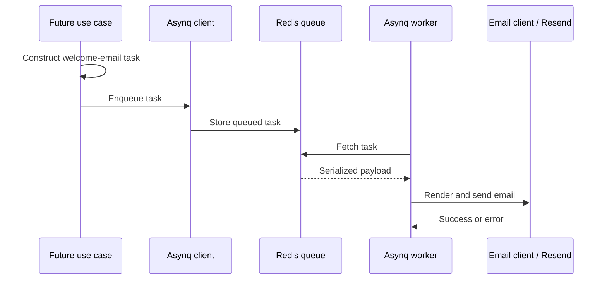

# Shared Libraries: Jobs, Email, and Small Utilities

Back to [../../docs/README.md](../../docs/README.md). These packages are reusable capabilities, not independent HTTP endpoints.

## File Map

| File | Responsibility |
| --- | --- |
| [job/job.go](job/job.go) | Asynq producer client, worker server, Redis address, queues, start/stop |
| [job/email_tasks.go](job/email_tasks.go) | Welcome task type, payload, and task-construction options |
| [job/handlers.go](job/handlers.go) | Initialize the mail client, decode a queued payload, and execute delivery |
| [email/client.go](email/client.go) | Read/render HTML templates and call Resend |
| [email/emails.go](email/emails.go) | Welcome-email-specific subject and template data |
| [email/templates.go](email/templates.go) | Template identifiers |
| [email/preview.go](email/preview.go) | Sample rendering data, not an automatically registered preview route |
| [utils/utils.go](utils/utils.go) | `PrintJSON` debugging utility; avoid printing secrets |

## Jobs Are a Separate Flow From HTTP

This diagram includes a future caller. `NewWelcomeEmailTask` constructs a task; it does not enqueue it. Starting the worker does not invent tasks. A use case must explicitly call the Asynq client to enqueue work.

The current server constructor starts the worker in the same Go process as the API. It is not a separate worker container. Redis is the external queue store. `Services.Job` exposes that existing job service.

## Task Handler vs. HTTP Handler

An HTTP handler takes `echo.Context` and writes an HTTP response. An Asynq task handler receives `context.Context` and `*asynq.Task`, decodes its JSON payload, performs work, and returns an error or nil. Asynq can retry failed work according to its options; the browser is not waiting for this handler's HTTP response.

Queue names (`critical`, `default`, `low`) and worker concurrency configure processing, not user permissions. Retries mean a side effect can happen more than once, so future job design should consider idempotency.

## Email Rendering

`SendEmail` reads a template from the backend's relative `templates/emails` directory using Go's `html/template`, renders data into a buffer, then calls Resend. That file must be available when the process runs. It is not embedded by the database migration directive.

The repository also has TypeScript email tooling, but the Go runtime consumes the HTML file. Changing a template source elsewhere is not the same as changing the artifact the backend reads.

Initializing a Resend client proves neither that credentials are accepted nor that a message is delivered. Keep real outbound email out of learning tests unless deliberately configured for it.

## Current Boundaries

`job/handlers.go` stores its email client in a package-global variable initialized before the worker starts. This can complicate isolated tests or multiple differently configured job services. It is existing code, not an example of per-request state.

Redis uses a plain host/port address in both server and Asynq configuration. No HTTP endpoint, cron schedule, or business cache is created merely by declaring these packages.