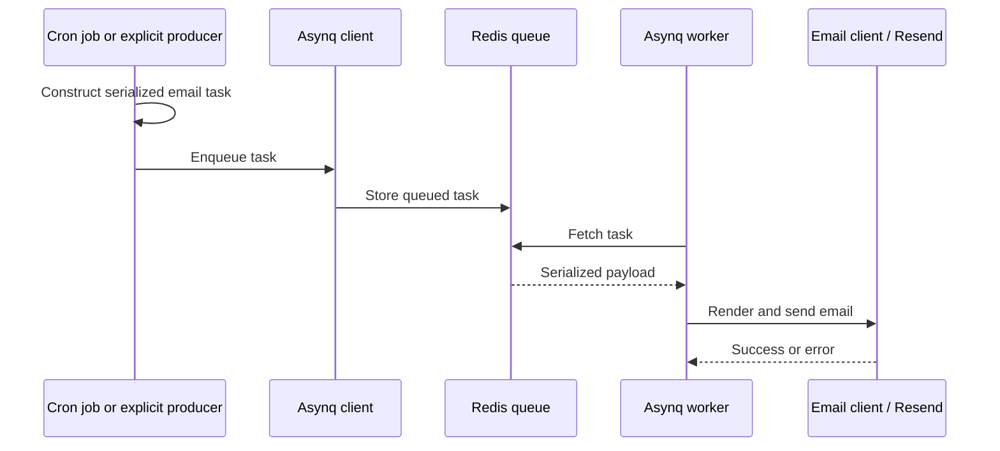
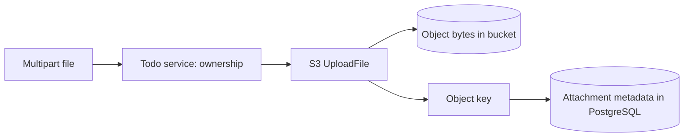

# Shared Libraries: Jobs, Email, Storage and Utilities

Back to [../../docs/README.md](../../docs/README.md). These packages are reusable capabilities, not independent HTTP endpoints.

## File Map

| File | Responsibility |
| --- | --- |
| [job/job.go](job/job.go) | Asynq producer client, worker server, Redis address, queues, start/stop |
| [job/email_tasks.go](job/email_tasks.go) | Welcome/reminder/report payloads and enqueue options |
| [job/handlers.go](job/handlers.go) | Initialize the mail client, decode a queued payload, and execute delivery |
| [email/client.go](email/client.go) | Read/render HTML templates and call Resend |
| [email/emails.go](email/emails.go) | Welcome/reminder/overdue/report subjects and template data |
| [email/templates.go](email/templates.go) | Template identifiers |
| [email/preview.go](email/preview.go) | Sample rendering data, not an automatically registered preview route |
| [utils/utils.go](utils/utils.go) | `PrintJSON` debugging utility; avoid printing secrets |
| [aws/aws.go](aws/aws.go) | AWS SDK configuration and S3-compatible endpoint |
| [aws/s3.go](aws/s3.go) | Upload, temporary download URL and object deletion |

## Jobs Are a Separate Flow From HTTP

The [cron jobs](../cron/README.md) enqueue reminders and weekly reports.
`NewWelcomeEmailTask` constructs a task but does not enqueue it. Its existence
does not mean a Clerk signup automatically sends a welcome email; a caller must
explicitly enqueue it.

The current server constructor starts the worker in the same Go process as the API. It is not a separate worker container. Redis is the external queue store. `Services.Job` exposes that existing job service.

## Task Handler vs. HTTP Handler

An HTTP handler takes `echo.Context` and writes an HTTP response. An Asynq task handler receives `context.Context` and `*asynq.Task`, decodes its JSON payload, performs work, and returns an error or nil. Asynq can retry failed work according to its options; the browser is not waiting for this handler's HTTP response.

Queue names (`critical`, `default`, `low`) and worker concurrency configure processing, not user permissions. Retries mean a side effect can happen more than once, so future job design should consider idempotency.

The worker has concurrency 10 and queue weights 6/3/1. Current email helpers
enqueue on `default`; defining `critical` does not place any task there by itself.
Reminder/report handlers resolve an email through the injected auth service
before rendering. The welcome payload already contains its recipient address.

## Email Rendering

`SendEmail` reads a template from the backend's relative `templates/emails` directory using Go's `html/template`, renders data into a buffer, then calls Resend. That file must be available when the process runs. It is not embedded by the database migration directive.

The repository also has TypeScript email tooling, but the Go runtime consumes the HTML file. Changing a template source elsewhere is not the same as changing the artifact the backend reads.

Initializing a Resend client proves neither that credentials are accepted nor that a message is delivered. Keep real outbound email out of learning tests unless deliberately configured for it.

## Current Boundaries

`InitHandlers` stores the email client on `JobService`, not in a package-global
variable. `SetAuthService` supplies the separate user-email lookup dependency.
The current mail sender still uses the sample `onboarding@resend.dev` address
and Boilerplate display name; successful delivery also depends on Resend policy
and recipient/domain setup.

Redis uses a plain host/port address in both server and Asynq configuration. No HTTP endpoint, cron schedule, or business cache is created merely by declaring these packages.

## S3 Storage

`UploadFile` buffers the entire reader in memory, detects content type and calls
`PutObject`. Its key is the supplied name plus Unix seconds, not a random UUID.
Same-name uploads within one second can collide; the key does not include a user
ID. Do not infer uniqueness or upload-size enforcement from this helper.

`CreatePresignedUrl` signs a GET for 60 minutes. The browser can use that URL
without receiving storage credentials. Database rows and object bytes have
separate cleanup lifecycles; see [the service guide](../service/README.md).

## Practice

Find which values are serialized into a reminder task and which are looked up
when the worker runs. Then explain why editing a React Email source file alone
does not change the HTML that the Go runtime reads.