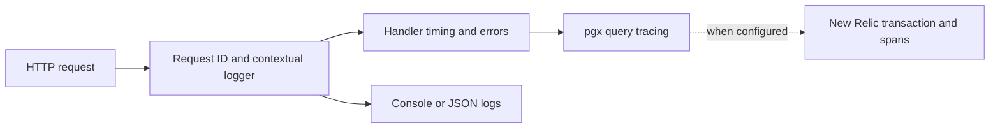

# Logging and Observability

Back to [../../docs/README.md](../../docs/README.md). All implementation in this folder is in [logger.go](logger.go).

## What Problem Does This Solve?

HTTP, SQL, and jobs run concurrently. Structured logs attach searchable fields to an event so you can connect a request ID, user ID, SQL failure, and elapsed time. New Relic adds optional distributed tracing and telemetry; it is not the database or a required destination for every local log.

| Function/type | Role |
| --- | --- |
| `LoggerService` / `NewLoggerService` | Own the optional New Relic application |
| `NewLoggerWithService` | Create the main Zerolog logger and choose its writer/level |
| `WithTraceContext` | Add trace/span metadata when a transaction is available |
| `NewPgxLogger` | Format database trace logs for local reading |
| `GetPgxTraceLogLevel` | Adapt between logger and pgx trace levels |
| `Shutdown` | Give New Relic time to shut down |

## Read the Fluent Logging Style

```go
logger.Info().Str("operation", "create_category").Msg("request completed")
```

This illustrative statement chooses a level, adds a structured field, then emits a message. A field named `operation` is easier to filter than embedding all details into a formatted sentence.

`With().Str(...).Logger()` instead derives a logger that carries fields for later messages. The middleware uses this to attach request information once.

## Actual Configuration Behavior

- An empty New Relic license key makes `NewLoggerService` return without an application. Logger creation and config validation are separate concerns.
- Failure to create a New Relic application also returns a service without an application; the function does not return an error to main.
- Production plus JSON format selects stdout JSON and, when available, the New Relic log writer. Other cases use a console writer.
- The DB constructor attaches pgx tracers for local logging and optional New Relic query instrumentation.

A request ID relates logs for one HTTP request. A trace ID can relate spans across instrumented operations/services. Neither is an authentication credential.



To investigate a failed create: inspect the browser's request/response, find
its request ID in API logs, follow service/repository context, and identify
whether failure occurred before SQL, during SQL, or while mapping the result.
Do not begin by changing timeout values without locating the failure boundary.

## Read Logs Without Over-Interpreting Them

`INF` is information, `WRN` a warning, and `ERR` an error; `FTL` ends the process. A 404 at an unregistered path is different from a database outage. Match the request ID and the returned HTTP response before assuming two messages represent two failures.

Avoid logging whole payloads, tokens, DSNs, or config structs. Current repository error strings can include titles/names, and mail logs include recipients; be conscious of personal data when sharing output. A log saying a request completed is not a substitute for an assertion on the stored data.