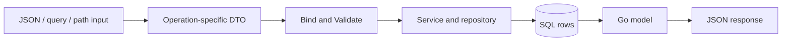

# Models and DTOs

[../../docs/README.md](../../docs/README.md) explains the whole backend; [../../docs/go-reading-basics.md](../../docs/go-reading-basics.md) explains the syntax used here.

## What This Folder Owns

Models describe Go data. DTOs (data transfer objects) describe input for specific operations. Neither one creates tables or runs SQL.

| File | Read it for |
| --- | --- |
| [base.go](base.go) | Shared ID/timestamps and generic `PaginatedResponse` |
| [todo/todo.go](todo/todo.go) | Todo fields, named status/priority types, metadata, populated responses, statistics |
| [todo/dto.go](todo/dto.go) | Create/update/detail/list/delete/statistics inputs and validation |
| [category/category.go](category/category.go) | A category row |
| [category/dto.go](category/dto.go) | Category input validation and list defaults |
| [comment/comment.go](comment/comment.go) | A comment row linked to a Todo |
| [comment/dto.go](comment/dto.go) | Comment operations and their path/body inputs |

The subfolders are separate packages so callers can write `todo.Todo`, `category.Category`, and `comment.Comment`. Repeated `Validate` methods follow one convention; you do not need to learn them as separate mechanisms.

## Three Representations of One Field

```go
UserId string `json:"userId" db:"user_id"`
```

| Representation | Consumer | Name |
| --- | --- | --- |
| Go field | Your Go code | `UserId` |
| JSON property | JSON encoder/decoder and frontend | `userId` |
| SQL column | pgx struct mapper | `user_id` |

A `db` tag does not rename the SQL column. It tells the mapper how to connect existing columns to fields. A `json` tag does not perform validation or authentication.



This is the intended feature boundary, not confirmation that Todo handlers already exist.

## Why Input and Output Types Differ

A create request should not choose its database ID, owner, or creation timestamp. `CreateTodoPayload` exposes editable inputs; the authenticated identity is passed separately; PostgreSQL supplies generated fields. The returned `Todo` contains the full stored result.

An update request only sends fields to change. That is why many update DTO fields are pointers even when the corresponding stored value is required.

For normal JSON decoding into a fresh `*string` field:

| Input | Pointer | Typical partial-update meaning |
| --- | --- | --- |
| Property absent | nil | Leave unchanged |
| `"description": ""` | Non-nil pointer to an empty string | Set to empty string |
| `"description": null` | nil | Indistinguishable from absent with this representation |

Consequently, the current pointer-based update builders cannot express every request to clear a nullable SQL column. That would need explicit presence tracking or a deliberate clear operation; a pointer alone is not enough.

## Validation and Defaults

`json`, `query`, and `param` tags tell a binder where input comes from. `validate` tags are interpreted by go-playground/validator when `Validate()` is called. Writing a method does not cause Go or Echo to invoke it automatically.

The intended rule `validate:"required,min=1,max=100"` rejects missing or overly long names. `oneof` restricts allowed sort/status values. Database constraints remain a separate protection: DTO validation can be bypassed by another caller or direct SQL.

List `Validate()` methods also fill defaults such as page 1 and limit 20. Repositories dereference these pointers, so a caller must first validate/default the query successfully. Passing a zero-valued query directly can panic or divide by zero.

Named types such as `type Status string` improve readability; they are not closed enums. Go still allows `Status("unexpected")`. A matching validator or database `CHECK` is needed to restrict the values.

## Stored vs. Populated vs. Summary Models

- `Todo` corresponds to one row, including the embedded `model.Base` fields.
- `PopulatedTodo` embeds that row and adds category, children, and comments assembled by a query.
- `TodoStats` corresponds to aggregate counts, not a physical table.
- `Metadata` is Go's typed view of the JSONB value; it is not another SQL table.
- `PaginatedResponse[T]` wraps rows and page/count information. It does not run pagination by itself.

Nested JSON produced by SQL is decoded using JSON names; ordinary result columns are mapped using `db` names. This explains why the SQL `camel()` helper appears in populated queries.

## Current Caveats, Not Patterns to Copy

In [todo/dto.go](todo/dto.go), the create-title validation tag is malformed and several validator tags contain leading spaces. Some rules can be ignored or cause an unknown-validator panic. The sort whitelist also spells `title` as `tittle`. These need tests and fixes before those DTOs can be treated as a reliable boundary.

UUID validation on a `uuid.UUID` field needs care: it is an array-backed Go type, while the `uuid` validator is normally used with strings. Test binding, zero UUIDs, and actual validation rather than assuming a valid-looking tag proves correctness.

The `CompletedAt` JSON/DB tags in the current Todo model are correctly quoted; an older explanation describing them as broken is no longer current.

Next: [../repository/README.md](../repository/README.md).