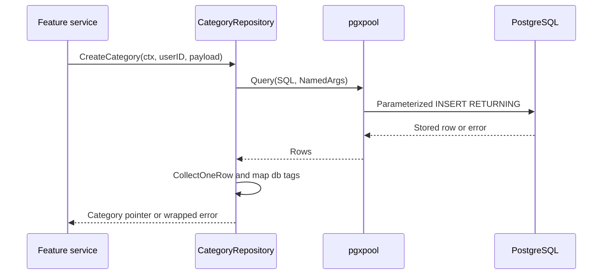

# Repositories: Go Values to SQL and Back

Start with [../model/README.md](../model/README.md). This folder owns feature data access. It receives a standard Go context, an explicit user ID, and operation inputs; it returns Go models or errors, not HTTP responses.

The code uses SQL and pgx directly, not an ORM. These are practical layers, not strict isolated clean-architecture boundaries: repositories depend on the shared `server.Server`, and some currently return application errors or apply defaults.

## File Map and Wiring

| File | Responsibility |
| --- | --- |
| [repositories.go](repositories.go) | The registry constructs `Todo`, `Category`, and `Comment` repositories |
| [category.go](category.go) | The simplest full CRUD and paginated-list example |
| [comment.go](comment.go) | Operations on comments linked to a Todo |
| [todo.go](todo.go) | Todo CRUD, populated reads, filters, pagination, statistics, attachments and cron queries |

`NewCategoryRepository(server)` stores the shared server pointer. `r.server.DB.Pool` then reaches the same pgx pool used by the other repositories. Creating a repository does not open a separate database or register a route.

## Walk Through CreateCategory Once

1. `ctx` carries cancellation/deadlines; `userID` must come from authenticated identity, not arbitrary request JSON.
2. `payload` is a pointer to operation input. The repository itself does not call its `Validate()` method.
3. The SQL inserts `user_id`, `name`, `color`, and `description` into `todo_categories`.
4. `pgx.NamedArgs` connects each `@name` in SQL with a Go value. pgx rewrites named placeholders into positional parameters; values stay separate from SQL syntax.
5. `Pool.Query` obtains a connection and starts the query. An error here can indicate connection, SQL, or parameter problems.
6. `RETURNING *` asks PostgreSQL for the inserted row, including its generated ID and timestamps.
7. `CollectOneRow(rows, RowToStructByName[category.Category])` scans that row into the model. Mapping or later database errors can still surface here. The collector closes the rows.
8. `return &categoryItem, nil` hands back the stored result. `%w` on error paths preserves the underlying error for classification.

## Query APIs and Resource Lifetimes

| API | Use here | Important detail |
| --- | --- | --- |
| `Query` + `CollectOneRow` | Insert/detail/update returning a model | Zero rows gives `pgx.ErrNoRows`; the helper returns the first row if several exist |
| `Query` + `CollectRows` | Lists | Zero matches is a successful empty result, not `ErrNoRows` |
| `QueryRow(...).Scan(&total)` | `COUNT(*)` | Scanning consumes the single result and reports its error |
| `Exec` | Delete with no returned row | `RowsAffected()` distinguishes deletion from no match |

For manually iterated rows, close them and check `rows.Err()` after the loop. The pgx collectors already handle closing. Unconsumed rows can hold a pool connection and make other requests wait.

Strict `RowToStructByName` mapping and `RETURNING *` couple the model to the full result shape. A newly added SQL column can require a Go model change. A successful Go build does not validate SQL strings or row mappings.

## The Other CRUD Patterns

**Read:** `WHERE id=@id AND user_id=@user_id` scopes a result to its owner. A UUID being hard to guess is not authorization.

**Update:** a `setClauses` slice collects assignments for supplied pointer fields, and `strings.Join` constructs the `SET` section. Reject an empty update. Check ownership in the update statement itself, even if a service also checked it earlier.

**Delete:** `Exec` returns a command tag. Zero affected rows can mean missing or not owned; returning the same not-found result avoids disclosing another user's data.

The current error style differs: Todo deletion returns a typed not-found error, while category/comment deletion returns plain errors. An HTTP layer must classify these deliberately; a plain `fmt.Errorf("category not found")` is not automatically a 404.

## Lists, Filters, Sorting, and Pagination

Both category and Todo lists build filters from supplied query fields. Filtering values belongs in parameters. Sorting identifiers cannot be bound as a value parameter, so SQL column names and `ASC`/`DESC` must come from a strict allowlist.

The current implementations concatenate sort inputs and rely on caller validation. Do not call them with unvalidated input. Named parameters elsewhere do not protect concatenated SQL.

For page 3 with limit 20, `OFFSET = (3 - 1) * 20 = 40`. The list returns that page; a separate count query returns the total number of matches. `TotalPages = (total + limit - 1) / limit` rounds up for positive integer limits.

Count and list must use the same filters. They are separate statements and can observe changes between them without a suitable transaction. Stable ordering should also include a tie-breaker when the primary sort field is not unique.

## What Is Different in Todo and Comment Operations?

| Operation | New concept, beyond ordinary CRUD |
| --- | --- |
| `GetTodoByID` / `GetTodos` | Joins plus JSON aggregation to return category, children, comments and attachments |
| `CheckTodoExists` | Returns a full unpopulated Todo, not a boolean; useful for checking ownership before related work |
| Root Todo listing | Adds `parent_todo_id IS NULL` unless a parent filter is supplied |
| Todo update | Sets `completed_at` when completing; clears it when changing to a non-completed status |
| `GetTodoStats` | `COUNT(CASE WHEN ... THEN 1 END)` counts matching rows because unmatched cases are NULL |
| Comment insertion | Needs an existing Todo, but its foreign key alone does not prove that the Todo belongs to this user |
| Category uniqueness | SQL enforces uniqueness of `(user_id, name)`, including concurrent attempts |

For populated reads, `LEFT JOIN` retains a Todo without a related row, `FILTER` removes missing children, `jsonb_agg` assembles arrays, and `COALESCE(..., '[]'::jsonb)` supplies an empty array. The project's `camel()` helper converts column names for nested JSON decoding.

## Important Limitations in the Current Todo Queries

These are source-code observations, not results of running the endpoints. Documentation work does not fix them:

- Current SQL uses `todo_comments`, parenthesized search and a spaced `ORDER BY`. Earlier spelling/syntax observations are obsolete.
- Joining children, comments and attachments multiplies rows: two children, three comments and two attachments produce twelve joined rows. Current aggregates do not deduplicate arrays or aggregate each relationship separately.
- PATCH assigns only non-nil pointers. For nullable scalar fields, JSON null and an omitted field both decode to nil, so clearing a description/category/due date is not represented distinctly.
- Textual priority sorting is lexical, not an explicit high/medium/low business ranking.
- Statistics count all owned todos, including subtasks; the default list returns roots. Their totals can legitimately differ.
- Empty-list branches expecting `CollectRows` to return `ErrNoRows` will not be used for ordinary empty results.

Services now perform same-user checks for parent/category links and comment
insertion. Other repository callers must preserve those checks. Foreign keys
enforce existence, not ownership; the schema blocks self-parenting, not every
possible hierarchy problem.

## How to Learn and Verify This Layer

Read Category creation fully, then compare its detail/update/delete methods. Next read category pagination, then Todo's extra filters and populated response, then comments and statistics. Do not memorize repeated error wrappers.

A useful repository test matrix is: successful write/read, missing row, another user's ID, invalid foreign key, duplicate category name, empty list, pagination boundaries, two children plus three comments, and search that matches another user's description. Use a disposable migrated database, not valuable local data.

Next: [../service/README.md](../service/README.md).