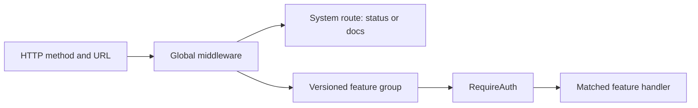

# Routing: Which Code Receives a Request?

Back to [../../docs/README.md](../../docs/README.md).

| File | Responsibility |
| --- | --- |
| [router.go](router.go) | Creates Echo, assigns the global error handler, installs global middleware, and groups routes |
| [system.go](system.go) | Registers currently available infrastructure endpoints |
| [v1/v1.go](v1/v1.go) | Calls the feature registration functions |
| [v1/todo.go](v1/todo.go) | Todos, statistics, nested comments and attachments |
| [v1/category.go](v1/category.go) | Category collection and mutations |
| [v1/comment.go](v1/comment.go) | Comment mutations |

## Current Routes

| Method/path | Handler or behavior |
| --- | --- |
| `GET /status` | `Health.CheckHealth` |
| `GET /docs` | `OpenAPI.ServeOpenAPIUI` |
| `/static/*` | Files from the backend's static directory, including the OpenAPI JSON |

There is no root `/` page, so browsing port 8080 at `/` can correctly return 404. The frontend is a separate application, not HTML automatically served by the Go backend.

`router.Group("/api/v1")` supplies the common prefix. `RegisterV1Routes` attaches
the feature routes below. Each feature group applies `RequireAuth`. The
`services` argument to `NewRouter` remains unused; services reach handlers
through their constructors, not through this parameter.

All paths in this table are relative to `/api/v1`:

| Method | Path | Operation |
| --- | --- | --- |
| GET, POST | `/todos` | List, create |
| GET | `/todos/stats` | Aggregate counts |
| GET, PATCH, DELETE | `/todos/:id` | Detail, update, delete |
| GET, POST | `/todos/:id/comments` | List comments, add comment |
| PATCH, DELETE | `/comments/:id` | Update/delete a comment |
| POST | `/todos/:id/attachments` | Upload multipart field `file` |
| DELETE | `/todos/:id/attachments/:attachmentId` | Delete attachment |
| GET | `/todos/:id/attachments/:attachmentId/download` | Return `{url}` for download |
| GET, POST | `/categories` | List, create |
| PATCH, DELETE | `/categories/:id` | Update, delete |

There is no registered category-detail GET route, despite a repository method
with that purpose. A layer method is not automatically a public API.



## Read a Registration

```go
r.GET("/status", h.Health.CheckHealth)
```

This tells Echo to invoke the method value `h.Health.CheckHealth` for that method/path combination. It does not invoke the method immediately. Startup stores the handler; a later matching HTTP request calls it.

A path such as `/api/v1/todos/:id` captures the ID from the URL. The method also
matters: registering GET does not register POST, PATCH, or DELETE.

## Middleware and Authentication

The router installs rate limiting, CORS, security headers, request IDs, tracing, context enrichment, logging, and panic recovery. Global middleware can affect requests even when no feature route matches.

`RequireAuth` is attached in the versioned feature registration files, not as a
global requirement for `/status` or `/docs`. Initializing Clerk's key alone
would not protect endpoints; attaching the middleware is the decisive step.

## Frontend Connection, Briefly

The browser runs the frontend and makes HTTP requests to the backend origin. Origin includes scheme, hostname, and port, so ports 3000 and 8080 are different origins. CORS controls browser access to cross-origin responses; it is not authentication and does not prevent direct HTTP clients from sending requests.

Shared TypeScript contracts describe expected API shapes, but they do not generate this Go route table or prove the Go implementation follows them. Add the backend handler, route, and tests as well as the client contract.

Follow the request into [../handler/README.md](../handler/README.md).