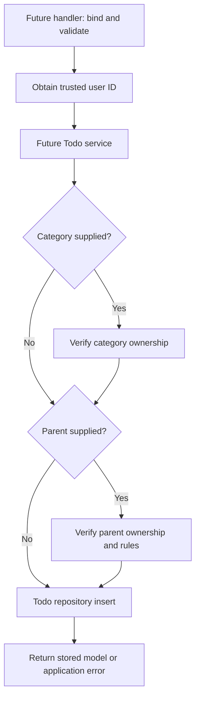

# Services: Where a Feature Becomes a Use Case

Read [../repository/README.md](../repository/README.md) first. A repository knows how to store data. A service decides whether and in what sequence the application should perform an operation.

## What Exists Right Now

| File | Current behavior |
| --- | --- |
| [auth.go](auth.go) | `NewAuthService` configures the Clerk SDK key and retains the server pointer |
| [services.go](services.go) | Constructs Auth and exposes the already-created Job service |

`NewServices(s, repos)` accepts the repository registry, but does not yet use it. There is no Todo, Category, or Comment service in this folder at this snapshot. AuthService itself is not the token-verification middleware.

## Why Not Call the Repository Directly From Every Handler?

Some operations need more than one query or a decision that does not belong to HTTP:

- The requested category and parent Todo must belong to the authenticated user.
- A parent change must not introduce a hierarchy cycle.
- A comment may only be added to a Todo the user can access.
- A state transition may require several writes to succeed together.
- A background job should be queued only after the relevant database write succeeds.

A service keeps these rules consistent if the operation is later called from HTTP, a job, or another entry point. Do not introduce elaborate abstractions for a simple operation; a small service method is enough.

## Planned CreateTodo Flow

This is a design walkthrough, not an implemented method or registered API:

Pass standard `context.Context` and the trusted user ID explicitly into repositories. Reading identity at the HTTP/service boundary is a design choice; accepting an unverified `userId` from the browser is not authentication.

## Wiring the Future Service

When implementing it, the changes must connect:

1. Define a service struct holding the dependencies it actually uses.
2. Give it an ordinary `NewTodoService` constructor and use-case methods.
3. Add it to `Services` and construct it using `repos.Todo`, `repos.Category`, and any required dependencies.
4. Add a handler that invokes it, and register that handler on an authenticated route.
5. Add tests at the service boundary and for the resulting HTTP path.

Names in this list describe proposed work, not existing symbols. Merely adding a file under this directory will not make it run.

## Errors, Transactions, and Races

Use `errors.Is(err, pgx.ErrNoRows)` through wrapped errors when classifying a missing record. Return a typed application error where the client needs a meaningful status; do not return raw SQL details to clients.

An existence check followed by an update can race with another request. Keep ownership conditions in the write SQL and rely on constraints as well as service checks.

For an atomic multi-query operation, all statements must run on the same transaction. Current repositories call `server.DB.Pool` directly; starting a transaction in a service does not magically move those calls onto it. Transaction-aware repository methods or a small shared query interface would be needed when implementing such an operation.

PostgreSQL commit and Redis enqueue are not one atomic operation. For reliable delivery, retry and idempotency matter; a durable outbox is a later option, not an existing feature here.

## Decide Which Layer Owns a Change

| Change | Usual home |
| --- | --- |
| JSON binding or HTTP status | Handler |
| Whether a user may attach a parent/category | Service, backed by database protections |
| Efficient SQL for fetching a row | Repository |
| Uniqueness or foreign-key guarantee | Migration/database |
| Input type and basic field validation | Model DTO |

Current Todo repository defaults and completion-timestamp logic illustrate that the code is not perfectly separated. Understand the existing behavior before choosing to move it; these docs do not refactor it.