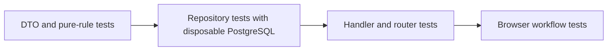

# Testing the Backend Safely

Back to [../../docs/README.md](../../docs/README.md). This is a local helper package named `testing`; it is distinct from Go's standard-library `testing` package. Import it under an alias such as `testutil` when a test needs both.

## File Map

| File | What it supplies |
| --- | --- |
| [container.go](container.go) | Disposable PostgreSQL container, dynamic port, database pool, applied migrations, cleanup |
| [server.go](server.go) | A lightweight `server.Server` value containing config, logger, and the test DB |
| [helpers.go](helpers.go) | `SetupTest`, JSON marshaling, finding the Go module root, and `Ptr[T]` |
| [transaction.go](transaction.go) | Transaction callbacks with commit-on-success or always-rollback behavior |
| [assertions.go](assertions.go) | Shared UUID/timestamp/value comparison assertions |

## What SetupTest Actually Does

1. `SetupTestDB` asks Testcontainers to start PostgreSQL with test-only credentials and an isolated database name.
2. It discovers the dynamically mapped host port, rather than assuming your local port 5432.
3. It constructs configuration directly and connects through the application's database constructor.
4. It applies embedded migrations using `database.Migrate`.
5. `CreateTestServer` wraps that pool in a server value usable by repositories.
6. A returned cleanup closes the pool; registered `t.Cleanup` terminates the container.

Docker must be available, and the first run may need to download an image. The helper currently uses PostgreSQL 15, while local Compose uses PostgreSQL 16. That difference is worth aligning or testing deliberately.

This helper does **not** call production `server.New`, start an HTTP listener, start Redis, configure real Clerk credentials, or send email. A Redis address in its config is not a provisioned Redis test service.

## Choose the Smallest Useful Test

| Level | What it proves | Typical dependencies |
| --- | --- | --- |
| DTO/unit | Input validation, defaults, pure rules | No database |
| Repository integration | SQL, row mapping, ownership predicates, constraints | Disposable migrated PostgreSQL |
| Service | Use-case decisions and sequencing | Controlled dependencies, possibly a DB |
| Handler/router | Binding, identity boundary, status/body, route registration | Echo plus `httptest`; explicitly supplied dependencies |
| End to end | Browser-to-API behavior | Running frontend, backend, auth, and infrastructure |

Do not claim integration coverage because a helper exists. Go runs functions in test files that invoke it. An empty test run or a startup ping is not a CRUD test.

At this documentation snapshot, no `_test.go` files are present under the actual
backend app. Tests in a separate reference checkout are not tests of this tree.
The table below describes a future test plan, not completed coverage.

## Transaction Helpers: Read the Implementation

`WithTransaction` begins a transaction, invokes the callback, and **commits on success**, despite its current comment saying it rolls back afterward. The deferred rollback covers error/early-return paths.

`WithRollbackTransaction` always rolls back when its callback returns. Only queries executed through the supplied `pgx.Tx` are inside that transaction. Current repositories use `server.DB.Pool` directly, so calling a repository from that callback does not automatically make its writes rollback-only.

For repository integration tests, use an isolated disposable database or deliberately add transaction-aware repository plumbing; never assume a surrounding transaction protects unrelated pool calls.

## Useful Test Progression for Your Feature

1. Validate Category create input and query defaults without Docker.
2. Insert and fetch a category using `SetupTest`; check its owner, ID, and fields.
3. Verify another user's ID cannot read/update/delete it.
4. Verify duplicate category names for one user are rejected but different users can share a name.
5. Exercise Todo's more complex joins with multiple children and comments.
6. Add service tests for related-record ownership used by the existing handlers.
7. Test invalid JSON, invalid IDs, missing authentication, not found, and successful responses through the router.

From the backend directory, use `go test ./internal/model/...` for the model packages or `go test ./internal/repository/...` for repository tests once added. `go test -race` can help detect shared request-state races. Tests with build constraints need their declared tags; these helpers do not automatically require an `integration` tag.

Never point cleanup helpers or migration tests at a valuable local/shared database. A Docker named volume is persistence, not a backup.