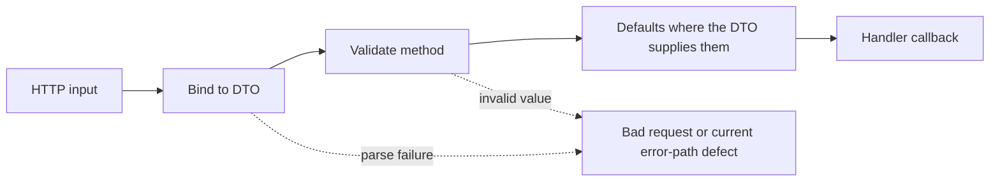

# Binding and Validation

Back to [../../docs/README.md](../../docs/README.md). The implementation is [utils.go](utils.go); operation-specific rules live with [../model/README.md](../model/README.md).

## Two Different Steps

**Binding** parses HTTP input into a Go value. A date, UUID, or integer with the wrong representation can fail here. **Validation** checks a parsed value against allowed lengths, ranges, required fields, and other rules.

`Validatable` is a small interface containing `Validate() error`. A DTO with that method satisfies it without declaring an `implements` relationship.

`BindAndValidate` does the following:

1. Calls Echo's `c.Bind(payload)` using the DTO's path/query/JSON tags.
2. Calls `payload.Validate()` through the interface.
3. Converts recognized validation errors into `errs.FieldError` entries.
4. Returns a bad-request application error when validation fails.

The handler helper invokes this function. A repository called directly does not inherit these checks automatically.

Todo list defaults are page 1, limit 20, sort `created_at`, order `desc`.
Category list defaults are page 1, limit 50, sort `name`, order `asc`.
This difference is intentional in the current DTOs; do not assume every list
uses the same default page size.

## Field Errors and Custom Rules

`extractValidationErrors` translates validator tags such as `required`, `min`, `max`, and `oneof` into readable messages. `CustomValidationErrors` provides another expected error format for application-defined field checks. `IsValidUUID` is a regex helper; it is not a database lookup or authorization check.

The extractor lowercases Go field names rather than reading JSON tags, so a multiword property may not use the exact frontend camelCase name. Do not assume all request/response error names match automatically.

## Current Fragility to Understand

The bind-error branch splits the error message string and indexes pieces without checking lengths. An unexpected error format can panic. The validation extractor also assumes any non-validator error is `CustomValidationErrors`; an arbitrary plain error can panic on that type assertion.

These should be covered when adding handler tests: malformed JSON, invalid query types, missing fields, oversized input, unknown custom errors, and valid input. Successful binding does not establish ownership, SQL safety for concatenated identifiers, or permission to modify a related resource.