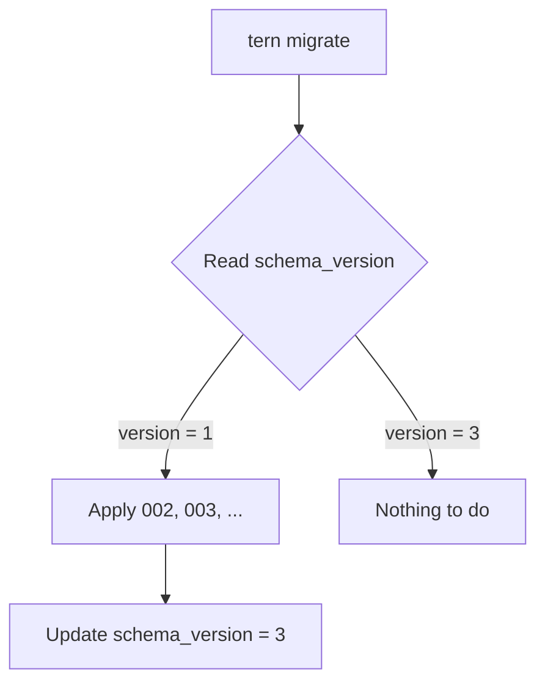

# Chapter 3: Migrations with Tern

Your schema will change over time. This chapter explains **why migrations exist**, **how Tern works**, and **exactly how this project runs them**.

---

## 3.1 The Problem Migrations Solve

Imagine three developers and a production server, all with a `todos` table. Now you need to add a `priority` column.

Without migrations, you'd have to:

1. Manually run `ALTER TABLE` on your local DB
2. Tell your teammates to run the same SQL
3. Remember to run it on staging
4. Remember to run it on production
5. Hope nobody forgot, ran it twice, or ran it out of order

This is fragile. **Migrations turn schema changes into versioned, ordered, repeatable files.**

> **Migrations are version control for your database schema.**

---

## 3.2 What a Migration Is

A migration is a **numbered SQL file** that describes one change. Pending versions are applied in order; successfully recorded versions are skipped on the next forward run. This is not automatic schema comparison: editing an already-applied file does not rerun it.

```
migrations/
  001_setup.sql    ← applied first
  002_todos.sql    ← applied second
  003_add_tags.sql ← applied third (hypothetical)
```

The database itself remembers how far it has been migrated, so re-running is safe.

---

## 3.3 Tern

This project uses **[Tern](https://github.com/jackc/tern)** — a lightweight migration tool built specifically for PostgreSQL.

Tern tracks state in a table called **`schema_version`** (created automatically on first run). It stores a single row with the current version number.



### Why Tern?

| Feature | Benefit |
| :--- | :--- |
| PostgreSQL-native | No abstraction layer, uses real PG features |
| Up **and** down scripts | Roll forward and backward |
| Embedded-friendly | Can be used as a Go library (this project does) |
| Simple | Plain `.sql` files, no DSL to learn |

---

## 3.4 The Up / Down Structure

A reversible Tern migration has two sections, separated by a marker. A forward-only migration omits the down section and separator:

```sql
-- Write your migrate up statements here

CREATE TABLE todos (
    id UUID PRIMARY KEY DEFAULT gen_random_uuid(),
    title TEXT NOT NULL
);

---- create above / drop below ----

-- Write your migrate down statements here

DROP TABLE todos;
```

| Section | Purpose |
| :--- | :--- |
| **Up** (above the marker) | How to *apply* the change |
| **Down** (below the marker) | How to *undo* it |

The marker line is exactly:

```
---- create above / drop below ----
```

> If a migration is irreversible, you can delete the marker — but then you lose the ability to roll back.

Both current project migrations are forward-only. They do not contain down SQL. If Tern reports `no sql in forward migration step`, verify that executable SQL is above the separator, not only below it. Dropping tables in a down migration would also destroy their data; reversal is not automatically safe.

### Why have a "down"?

- **Local development** — quickly undo a bad migration
- **Rollbacks** — revert a deploy that broke something
- **Confidence** — writing the down forces you to think about reversibility

---

## 3.5 Creating a Migration

This project wraps Tern in a Taskfile task. From [Taskfile.yml](../../apps/backend/Taskfile.yml):

```yaml
migrations:new:
  desc: create a new database migration
  vars:
    NAME: '{{.name | default ""}}'
  cmds:
    - |
      if [ -z "{{.NAME}}" ]; then
        echo "Error: name parameter is required"
        echo "Usage: task migrations:new name=migration_name"
        exit 1
      fi
    - echo 'Creating migration file for {{.NAME}}...'
    - tern new -m ./internal/database/migrations {{.NAME}}
```

### Usage

```bash
cd apps/backend
task migrations:new name=todos
```

> **Important:** Taskfile variables use an **equals sign** (`name=todos`), **not** a colon. Writing `name:todos` makes Task think you're naming a task, and you'll get `Task "name:todos" does not exist`.

This creates a new file with the next number, e.g. `002_todos.sql`, pre-filled with the up/down skeleton.

### Prerequisite: the Tern CLI

The `tern` **binary** must be installed (it is separate from the Go library dependency):

```bash
go install github.com/jackc/tern/v2@v2.3.3
```

This matches the library version currently pinned in [../../apps/backend/go.mod](../../apps/backend/go.mod). Make sure Go's install directory (`GOBIN`, or normally `$(go env GOPATH)/bin`) is on PATH. Verify with:

```bash
command -v tern
tern version
```

---

## 3.6 Applying Migrations

### Manually (local development)

```yaml
migrations:up:
  desc: apply all up database migrations
  deps: [ confirm ]
  cmds:
    - echo 'Running up migrations...'
    - tern migrate -m ./internal/database/migrations --conn-string {{.tasker_DB_DSN}}
```

Run it from the backend directory with the DSN for the intended database. This example matches the current local passwordless setup, not production:

```bash
task migrations:up tasker_DB_DSN="postgres://postgres@localhost:5432/tasker?sslmode=disable"
```

Note the `deps: [ confirm ]` — it prompts for confirmation before touching the database:

```yaml
confirm:
  cmds:
    - |
      echo -n 'Are you sure? [y/N] ' && read ans && [ ${ans:-N} = y ]
```

The Taskfile defaults the DSN to an empty string. The Go dotenv loader does not configure this separate CLI process. Inspect the target before confirming; do not put a production password into shell history.

### Automatically (staging / production)

In production, migrations run **on server boot**. From [main.go](../../apps/backend/cmd/tasker/main.go):

```go
if cfg.Primary.Env != "local" {
    if err := database.Migrate(context.Background(), &log, cfg); err != nil {
        log.Fatal().Err(err).Msg("failed to migrate database")
    }
}
```

> **Key detail:** migrations auto-run **only when `Env != "local"`**. Locally, *you* run them manually — giving you control while developing.

---

## 3.7 How This Project Runs Migrations Programmatically

Instead of shelling out to the CLI, production uses the **Tern Go library**. From [migrator.go](../../apps/backend/internal/database/migrator.go):

```go
//go:embed migrations/*.sql
var migrations embed.FS
```

The `//go:embed` directive **bakes the SQL files into the compiled binary**. Production doesn't need the `.sql` files on disk — they ship inside the executable.

The following is an abbreviated walkthrough, not a complete compilable function:

```go
func Migrate(ctx context.Context, logger *zerolog.Logger, cfg *config.Config) error {
    // 1. Build the DSN (same as database.go)
    dsn := fmt.Sprintf("postgres://%s:%s@%s/%s?sslmode=%s", ...)

    // 2. Open a single connection
    conn, err := pgx.Connect(ctx, dsn)
    if err != nil {
        return err
    }
    defer conn.Close(ctx)

    // 3. Create a migrator bound to the schema_version table
    m, err := tern.NewMigrator(ctx, conn, "schema_version")
    if err != nil {
        return fmt.Errorf("constructing database migrator: %w", err)
    }

    // 4. Load the embedded .sql files
    subtree, err := fs.Sub(migrations, "migrations")
    if err != nil {
        return fmt.Errorf("retrieving database migrations subtree: %w", err)
    }
    if err := m.LoadMigrations(subtree); err != nil {
        return fmt.Errorf("loading database migrations: %w", err)
    }

    // 5. Read current version, then apply everything newer
    from, err := m.GetCurrentVersion(ctx)
    if err != nil {
        return fmt.Errorf("retreiving current database migration version")
    }
    if err := m.Migrate(ctx); err != nil {
        return err
    }

    // 6. Log the outcome
    if from == int32(len(m.Migrations)) {
        logger.Info().Msgf("database schema up to date, version %d", len(m.Migrations))
    } else {
        logger.Info().Msgf("migrated database schema, from %d to %d", from, len(m.Migrations))
    }
    return nil
}
```

### Step-by-step

| Step | What happens |
| :--- | :--- |
| 1 | Build the DSN from config |
| 2 | Open **one** connection (migrations are serial, no pool needed) |
| 3 | Bind to the `schema_version` tracking table |
| 4 | Load `.sql` files from the embedded filesystem |
| 5 | Read current version, apply all newer migrations |
| 6 | Log whether anything changed |

---

## 3.8 The `schema_version` Table

Tern creates and maintains a version table with a `version` column, not the `version`/`dirty` schema used by some other migration tools:

| version |
| --- |
| 2 |

Ordinary Tern migrations run transactionally, so a failed step normally rolls back with its version update. Explicitly nontransactional operations require separate care. Do not manually change the version to hide a SQL failure; inspect the failed SQL and actual schema first.

You can inspect it directly:

```bash
docker exec -it tasker-postgres psql -U postgres -d tasker -c "SELECT * FROM schema_version;"
```

---

## 3.9 Best Practices

### ✅ Do

- **One logical change per migration** — easier to review and roll back
- **Always write the down script** — unless truly irreversible
- **Never edit an applied migration** — add a new one instead
- **Test migrations on a copy** before production
- **Use guards deliberately**; `IF NOT EXISTS` can hide a schema mismatch and is not a replacement for tracking versions

### ❌ Don't

- **Don't rename a migration file** after it's applied — Tern tracks by number
- **Don't delete migrations** that have run in production
- **Don't mix unrelated changes** in one file
- **Don't rely on data existing** — migrations should work on an empty DB

---

## 3.10 Common Commands Cheat Sheet

The raw Tern commands below also need the migration path and connection string, for example `-m ./internal/database/migrations --conn-string "$local_dsn"`, with `local_dsn` set to your intended local database. Run them from the backend directory.

| Command | Purpose |
| :--- | :--- |
| `task migrations:new name=foo` | Create `NNN_foo.sql` |
| `task migrations:up tasker_DB_DSN="$local_dsn"` | Apply all pending migrations after confirmation |
| `tern migrate --destination N` | Move to version N; moving backward requires down SQL and can destroy data |
| `tern status` | Show current migration status |
| `tern print-migrations` | List all migrations |

There is no `migrations:down` task in the current Taskfile. Creating a new file with `migrations:new` does not apply it.

---

## 3.11 Summary

| Concept | Meaning |
| :--- | :--- |
| Migration | A numbered, versioned SQL change |
| Up script | How to apply the change |
| Down script | How to undo the change |
| Tern | The migration tool used here |
| `schema_version` | Table tracking the applied version |
| `//go:embed` | Bakes SQL into the binary for production |
| Auto-migrate | Runs on boot when `Env != "local"` |

Next: **[Chapter 4: Project Schema Reference](04_project_schema_reference.md)** — a line-by-line tour of this project's actual tables.
