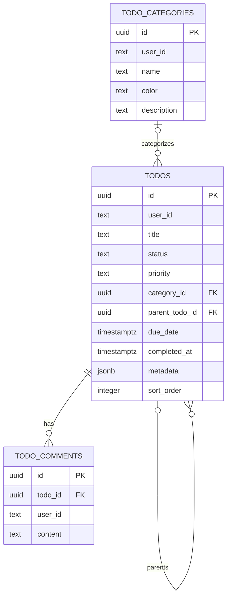

# Chapter 4: Tasker Schema Reference

Previous: [03_migrations_with_tern.md](03_migrations_with_tern.md). These are the definitions on disk, not a claim that your running database has applied them. Tern status or database inspection establishes that separately.

## Source Files

- [../../apps/backend/internal/database/migrations/001_setup.sql](../../apps/backend/internal/database/migrations/001_setup.sql): `camel()` and `trigger_set_updated_at()` functions.
- [../../apps/backend/internal/database/migrations/002_todos.sql](../../apps/backend/internal/database/migrations/002_todos.sql): three tables plus indexes, triggers, and a no-self-parent constraint.

Both current files contain forward SQL only. Helper functions must exist before the second migration attaches triggers that call them.

## Relationships

All three tables also have `created_at` and `updated_at`. `user_id` is text supplied by the application; these migrations do not create a users table or a foreign key to Clerk.

## Categories

`todo_categories` groups a user's Todos. Its unique index on `(user_id, name)` prevents two identical category names for that user, while allowing the same name for different users. It does not implement case-insensitive uniqueness.

`color` has a database default but is nullable. The create-category DTO currently requires a color, so an API request would be expected to supply one after validation. Database defaults and API validation are different layers.

Deleting a category sets referencing Todos' `category_id` to NULL; it does not delete those Todos.

## Todos

| Field group | Meaning |
| --- | --- |
| `id` / timestamps | Generated identity and audit times |
| `user_id` / `title` / `description` | Owner, required title, optional description |
| `status` / `priority` | Required text with defaults `draft` and `medium` |
| `due_date` / `completed_at` | Optional scheduling/completion instants |
| `parent_todo_id` | Optional self-referencing parent |
| `category_id` | Optional category reference |
| `metadata` | JSONB for extra structured data |
| `sort_order` | Sequence-backed integer generated by `SERIAL` |

The SQL does not restrict status/priority to Go's named constants. The database default for `completed_at` is not a status rule; current application update code manages that timestamp.

`SERIAL` uses a sequence. Values can have gaps, are not automatically scoped per parent/user, and do not by themselves implement drag-and-drop ordering.

`CHECK (id != parent_todo_id)` blocks a direct self-parent. It permits NULL for root Todos and does not prevent longer cycles. The parent foreign key uses PostgreSQL's default `NO ACTION`, so deleting a parent with remaining children can fail. It does not cascade-delete subtasks.

## Comments

Every `todo_comments` row has a required Todo reference and content. Deleting a Todo cascades to its comments. Comments have no `sort_order` column; chronological listing uses `created_at`.

The comment and its Todo can still have different `user_id` values under these constraints. Similarly, a Todo can reference another user's category or parent. The service/write path must enforce those ownership relationships, or the schema must be strengthened deliberately.

## Functions and Triggers

`trigger_set_updated_at()` assigns `CURRENT_TIMESTAMP` to the new row before update. All three tables attach it. PostgreSQL's `CURRENT_TIMESTAMP` is the transaction-start time, so multiple changes inside one transaction can share it.

`camel(input_row anyelement)` converts a composite row to JSONB, loops over its top-level fields, transforms snake_case names into camelCase, and assembles a result object. `anyelement` lets the same function receive different row types. `NEW`, `RETURN NEW`, and `RETURNS TRIGGER` belong to PostgreSQL trigger execution, not Go.

The conversion is shallow: it renames row fields, not arbitrary nested keys inside `metadata`. It exists to align SQL-generated nested JSON with Go's JSON tags in populated Todo queries.

## Indexes Are Access Paths, Not Feature Logic

The schema indexes ownership, category/parent references, status, priority, deadlines, hierarchy ordering, and a combined user/status/priority lookup. An index can speed eligible queries but costs writes and storage. Its presence does not prove a query is optimal; use realistic data and `EXPLAIN` when tuning.

The current repository's complex SQL has known issues described in [../../apps/backend/internal/repository/README.md](../../apps/backend/internal/repository/README.md). A valid schema alone cannot make malformed or incorrectly grouped SQL work.

Next: [05_query_lifecycle.md](05_query_lifecycle.md).