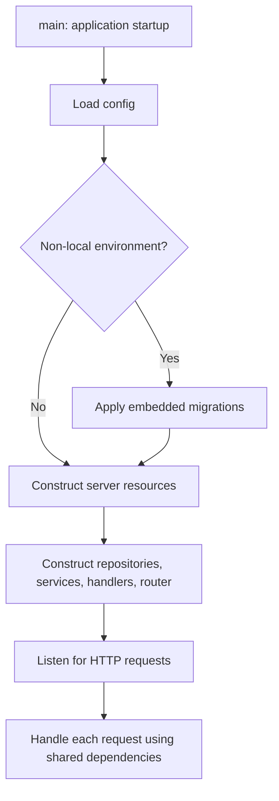

# Chapter 5: A Query's Journey

Previous: [04_project_schema_reference.md](04_project_schema_reference.md). Next: [06_local_infrastructure_and_data_browsing.md](06_local_infrastructure_and_data_browsing.md). For detailed line-by-line repository mechanics, use [../../apps/backend/internal/repository/README.md](../../apps/backend/internal/repository/README.md).

## Two Flows That Beginners Often Combine

**Startup** constructs shared dependencies once. **Request handling** uses them repeatedly. The backend does not rerun migrations and create a new pool for every HTTP call.



## Implemented Category Request

`POST /api/v1/categories` connects the following layers. This diagram follows
the current source; use a disposable database to verify actual behavior.

```mermaid
sequenceDiagram
    participant FE as Browser
    participant HTTP as Authenticated route and handler
    participant Service as Category service
    participant Repo as CategoryRepository
    participant PG as pgxpool / PostgreSQL
    FE->>HTTP: JSON body and authentication token
    HTTP->>HTTP: Verify identity; bind and validate a fresh DTO
    HTTP->>Service: Context, trusted user ID, payload
    Service->>Repo: CreateCategory
    Repo->>PG: INSERT with parameter values and RETURNING
    PG->>PG: Defaults, constraints, storage
    PG-->>Repo: Stored row
    Repo->>Repo: Map SQL columns to Go model
    Repo-->>Service: Model or error
    Service-->>HTTP: Result or application error
    HTTP-->>FE: JSON and HTTP status
```

## What Travels Between Layers?

| Boundary | What crosses it |
| --- | --- |
| Browser to server | HTTP headers, JSON/query/path values; not Go structs or SQL connections |
| Handler to service | Parsed Go input, request context, authenticated identity |
| Service to repository | An operation with explicit inputs |
| Repository to pgx | SQL text plus separate parameter values |
| pgx to PostgreSQL | PostgreSQL protocol messages |
| PostgreSQL to Go | Row values decoded and mapped to the requested model |
| Go to browser | JSON encoded using `json` tags |

## Failure Can Occur at Different Boundaries

- Bad JSON or a nonnumeric page can fail binding before any query.
- Missing required input can fail DTO validation.
- Another user's related ID can fail service authorization.
- A duplicate category name can fail the SQL unique constraint.
- A missing or mismatched `db` tag can fail row mapping even after PostgreSQL executes valid SQL.
- A canceled request or expired deadline can interrupt a query through its context.
- A malformed SQL string can compile as Go and then fail only when executed.

Each check proves something different. A `/status` ping does not execute a Category insert, and a repository test does not prove the router exposes it correctly. Use the [testing guide](../../apps/backend/internal/testing/README.md) to choose the right verification layer.