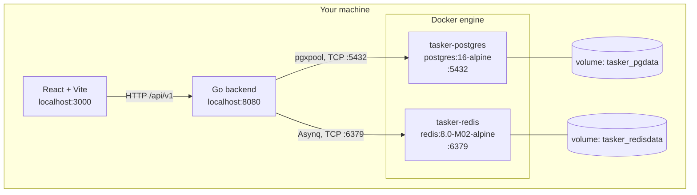
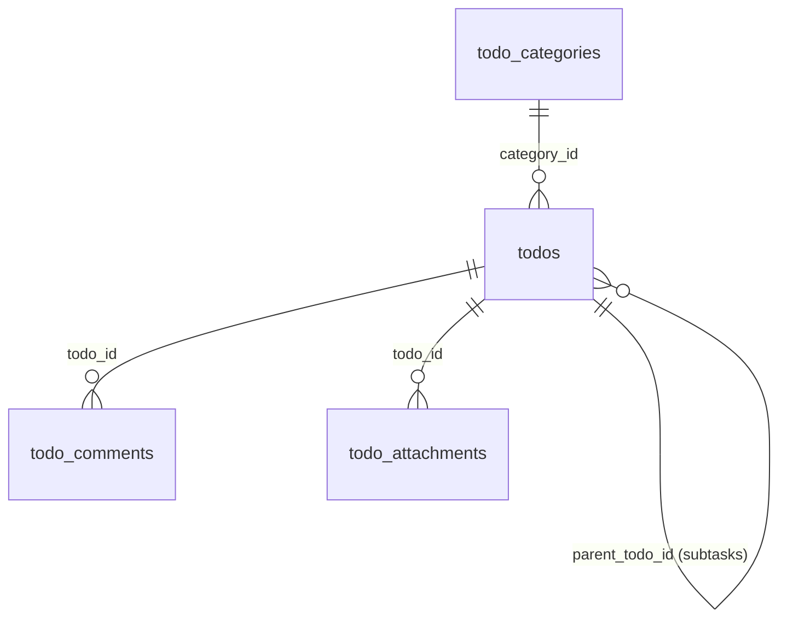
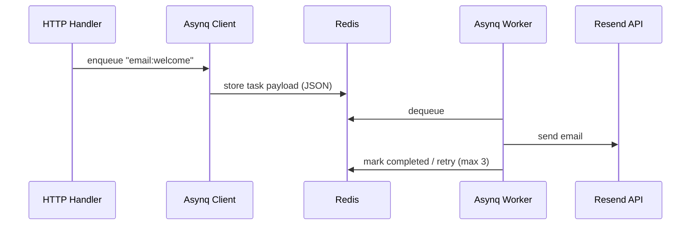

# Chapter 6: Local Infrastructure and Browsing the Data

Previous: [05_query_lifecycle.md](05_query_lifecycle.md). Back to the [database guide index](README.md).

This chapter answers the practical questions:

- **Why does this project use both PostgreSQL and Redis?**
- **Where are they actually running — my machine, or somewhere else?**
- **Where does the data physically live?**
- **How do I look at the data? Is there a UI?**

Everything below is tied to the real files in this repository, not a generic tutorial.

---

## 6.1 The Short Answer

| Component | Role | Where it runs | Address from your host |
| :--- | :--- | :--- | :--- |
| **PostgreSQL 16** | Durable relational storage (the system of record) | Docker container `tasker-postgres` | `localhost:5432` |
| **Redis 8** | In-memory job queue broker for Asynq | Docker container `tasker-redis` | `localhost:6379` |
| **Go backend** | HTTP API + queue workers | Your shell (`task run`) | `localhost:8080` |
| **React frontend** | Browser UI | Vite dev server (`bun dev`) | `localhost:3000` |

Both data stores are **local Docker containers** defined in [docker-compose.yml](../../docker-compose.yml). They are not cloud services. Nothing leaves your machine unless the app calls an external API (Resend for email, New Relic for telemetry).



---

## 6.2 Why PostgreSQL

PostgreSQL is the **system of record**. Anything that must survive a restart lives here.

The domain is genuinely relational, which is why a relational database is the right tool:

- A todo belongs to a category (`category_id`).
- A todo can have subtasks (`parent_todo_id` self-reference).
- A todo has comments (`todo_comments.todo_id`).
- A todo has attachments (`todo_attachments.todo_id`).

The schema also relies on database-level guarantees that a plain file or JSON store would not give you:

| Guarantee | Where it is defined |
| :--- | :--- |
| UUID primary keys | `id UUID PRIMARY KEY DEFAULT gen_random_uuid()` |
| Automatic `updated_at` | `trigger_set_updated_at()` trigger on every table |
| Unique category name per user | `todo_categories_unique_name` on `(user_id, name)` |
| No self-parenting todo | `CHECK (id != parent_todo_id)` |
| Cascade delete of comments/attachments | `REFERENCES todos ON DELETE CASCADE` |
| Category delete keeps todos | `REFERENCES todo_categories ON DELETE SET NULL` |
| Query performance | Indexes on `user_id`, `status`, `priority`, `due_date`, `category_id`, `parent_todo_id` |

### Schema files

| Migration | Contents |
| :--- | :--- |
| [001_setup.sql](../../apps/backend/internal/database/migrations/001_setup.sql) | `camel()` and `trigger_set_updated_at()` helper functions |
| [002_todos.sql](../../apps/backend/internal/database/migrations/002_todos.sql) | `todo_categories`, `todos`, `todo_comments` + indexes, triggers, constraints |
| [003_attachments.sql](../../apps/backend/internal/database/migrations/003_attachments.sql) | `todo_attachments` |



See [04_project_schema_reference.md](04_project_schema_reference.md) for the full column-by-column reference.

### How Go connects

[database.go](../../apps/backend/internal/database/database.go) builds a DSN from `.env` and creates a `pgxpool` connection pool:

```text
postgres://postgres:@localhost:5432/tasker?sslmode=disable
```

It then `Ping`s once at startup. That is the `INF connected to the database` line in the server log. If the ping fails, the process exits — the backend cannot start without Postgres.

---

## 6.3 Why Redis

Redis is **not** the database. In this project it has exactly two jobs.

### Job 1: It is the queue broker for background jobs (Asynq)

[internal/lib/job/job.go](../../apps/backend/internal/lib/job/job.go) creates an Asynq client and worker server pointed at `cfg.Redis.Address`:

```go
client := asynq.NewClient(asynq.RedisClientOpt{Addr: redisAddr})

server := asynq.NewServer(
    asynq.RedisClientOpt{Addr: redisAddr},
    asynq.Config{
        Concurrency: 10,
        Queues: map[string]int{
            "critical": 6,
            "default":  3,
            "low":      1,
        },
    },
)
```

The flow for a welcome email:



**Why not send the email inline?** Sending an email calls an external HTTP API. It can take seconds and it can fail. Blocking the user's HTTP request on that would make the API slow and fragile. Instead:

1. The request enqueues a small JSON task and returns immediately.
2. A worker goroutine picks it up.
3. Failures retry up to 3 times with backoff (`asynq.MaxRetry(3)` in [email_tasks.go](../../apps/backend/internal/lib/job/email_tasks.go)).
4. Tasks are routed by priority queue (`critical` / `default` / `low`).

Redis is used because it is in-memory and extremely fast at the "push a job / pop a job" pattern, and Asynq is built on top of it.

### Job 2: It is a health check target

[health.go](../../apps/backend/internal/handler/health.go) pings Redis and reports the result under `/status`:

```json
{
  "status": "healthy",
  "checks": {
    "database": { "status": "healthy", "response_time": "1.2ms" },
    "redis":    { "status": "healthy", "response_time": "0.4ms" }
  }
}
```

### What Redis is *not* used for here

The architecture document describes Redis as a "cache & queue", but in the actual code there is **no application caching** — no `GET`/`SET` of todo or category data anywhere. It is purely the Asynq broker plus a health probe.

### Redis is effectively required

[server.go](../../apps/backend/internal/server/server.go) logs *"Failed to connect to Redis, continuing without Redis"* when the ping fails, but then immediately calls `jobService.Start()`, which returns an error if Redis is unreachable. The server therefore fails to boot anyway. Treat Redis as a hard dependency.

---

## 6.4 Where the Data Physically Lives

The data is **not** in the repository. It lives in Docker named volumes:

| Volume | Host path | Purpose |
| :--- | :--- | :--- |
| `tasker_pgdata` | `/var/lib/docker/volumes/tasker_pgdata/_data` | PostgreSQL data files |
| `tasker_redisdata` | `/var/lib/docker/volumes/tasker_redisdata/_data` | Redis persistence (AOF/RDB) |

Consequences:

- `docker compose down` → containers removed, **data kept**.
- `docker compose down -v` → volumes removed, **data deleted**.
- Deleting the repo folder does not delete your data.
- Volumes are not backups. Copy them deliberately if the data matters.

---

## 6.5 Starting and Checking the Services

From the repository root:

```bash
docker compose up -d
docker compose ps
```

Expected output:

```text
tasker-postgres   postgres:16-alpine     Up   0.0.0.0:5432->5432/tcp
tasker-redis      redis:8.0-M02-alpine   Up   0.0.0.0:6379->6379/tcp
```

Non-destructive health checks:

```bash
docker exec tasker-postgres pg_isready -U postgres -d tasker
docker exec tasker-redis redis-cli ping
```

Expected: `accepting connections` and `PONG`.

### Applying migrations

`main.go` only auto-migrates when `Primary.Env != "local"`. With
`TASKER_PRIMARY.ENV="local"`, **migrations are manual**:

```bash
cd apps/backend
task migrations:up TASKER_DB_DSN="postgres://postgres@localhost:5432/tasker?sslmode=disable"
```

Check the applied version:

```bash
docker exec tasker-postgres psql -U postgres -d tasker -c 'SELECT version FROM schema_version;'
```

The number should match the highest migration file number (`003` → version `3`).

---

## 6.6 Browsing PostgreSQL

### Option A: `psql` inside the container (no install needed)

```bash
docker exec -it tasker-postgres psql -U postgres -d tasker
```

Useful commands inside `psql`:

```sql
\dt                          -- list tables
\d todos                     -- describe a table
\d+ todo_attachments         -- describe with storage details
SELECT * FROM todos;
SELECT * FROM todo_categories;
SELECT * FROM schema_version;
\x                           -- toggle expanded (vertical) output
\q                           -- quit
```

One-liners without entering the shell:

```bash
docker exec tasker-postgres psql -U postgres -d tasker -c 'SELECT * FROM todos;'
docker exec tasker-postgres psql -U postgres -d tasker -c '\dt'
```

Row counts across all tables:

```bash
docker exec tasker-postgres psql -U postgres -d tasker -c "
SELECT 'todos' AS table_name, count(*) FROM todos
UNION ALL SELECT 'todo_categories', count(*) FROM todo_categories
UNION ALL SELECT 'todo_comments', count(*) FROM todo_comments
UNION ALL SELECT 'todo_attachments', count(*) FROM todo_attachments;"
```

### Option B: A GUI client (recommended for browsing)

All of these use the same connection settings:

| Field | Value |
| :--- | :--- |
| Host | `127.0.0.1` (or `localhost`) |
| Port | `5432` |
| Database | `tasker` |
| User | `postgres` |
| Password | *(empty — `trust` auth)* |
| SSL mode | `disable` |

| Tool | Notes |
| :--- | :--- |
| **DBeaver** | Free, cross-platform, best general-purpose choice |
| **pgAdmin 4** | Official PostgreSQL GUI |
| **TablePlus** | Polished UI, free tier available |
| **VS Code: PostgreSQL** (`ms-ossdata.vscode-pgsql`) | Browse tables without leaving the editor |
| **VS Code: Database Client** (`cweijan.vscode-database-client2`) | Multi-database client extension |

> If you are on Windows connecting to WSL/Docker Desktop, `localhost` usually works via port forwarding. If it does not, verify the Docker context (`docker context show`) and the port mapping before changing network exposure.

---

## 6.7 Browsing Redis

### Option A: `redis-cli` inside the container

```bash
docker exec -it tasker-redis redis-cli
```

Useful commands:

```redis
PING
DBSIZE              -- number of keys
SCAN 0              -- incrementally list keys (safe)
TYPE <key>          -- what kind of value is it
TTL <key>           -- seconds until expiry (-1 = no expiry)
```

> Avoid `KEYS *` on anything but a tiny local instance, and never use `FLUSHALL` / `FLUSHDB` to "inspect" a queue — that destroys pending jobs.

### What Asynq keys look like

When a job is enqueued you will see keys such as:

| Key pattern | Meaning |
| :--- | :--- |
| `asynq:{default}:pending` | List of tasks waiting in the `default` queue |
| `asynq:{default}:t_<id>` | The task payload itself |
| `asynq:{default}:completed` | Recently completed tasks |
| `asynq:{default}:retry` | Tasks scheduled for retry |
| `asynq:{default}:scheduled` | Delayed tasks |

An empty `DBSIZE` means the selected Redis database has no keys now. It does not
prove no task was previously enqueued; keys may have expired, been removed or
been stored in another database.

### Option B: A GUI client

| Tool | Notes |
| :--- | :--- |
| **RedisInsight** | Free, official Redis GUI. Connect to `redis://127.0.0.1:6379` |
| **Another Redis Desktop Manager** | Lightweight desktop client |
| **VS Code: Redis** (`Redis.redis-for-vscode`) | Browse keys in the editor |
| **redis-commander** | `npx redis-commander` → web UI at `localhost:8081` |

---

## 6.8 The Application's Own UI

Once the backend is running (`cd apps/backend && task run`):

| URL | What it shows |
| :--- | :--- |
| `http://localhost:8080/status` | Live health JSON with `database` and `redis` checks and response times |
| `http://localhost:8080/docs` | OpenAPI / Swagger UI for the API |
| `http://localhost:8080/static/...` | Static assets served by Echo |

The frontend (`bun dev` from the repo root) runs at `http://localhost:3000` and talks to the API at `/api/v1`.

---

## 6.9 Quick Reference Card

```bash
# --- Start infrastructure ---
docker compose up -d
docker compose ps

# --- Health ---
docker exec tasker-postgres pg_isready -U postgres -d tasker
docker exec tasker-redis redis-cli ping

# --- Postgres: inspect ---
docker exec tasker-postgres psql -U postgres -d tasker -c '\dt'
docker exec tasker-postgres psql -U postgres -d tasker -c 'SELECT * FROM todos;'
docker exec tasker-postgres psql -U postgres -d tasker -c 'SELECT version FROM schema_version;'

# --- Redis: inspect ---
docker exec tasker-redis redis-cli dbsize
docker exec tasker-redis redis-cli --scan

# --- Migrations ---
cd apps/backend
task migrations:up TASKER_DB_DSN="postgres://postgres@localhost:5432/tasker?sslmode=disable"

# --- Run the API ---
task run
```

---

## 6.10 Gotchas and Caveats

1. **Review the sample Redis address.** The sample uses `TASKER_REDIS.ADDRESS="redis://localhost:6379"`, but current go-redis/Asynq consumers expect bare `localhost:6379`. Remove the scheme in your local configuration.

2. **Keep secrets private.** Local environment files are for credentials, not documentation examples. Check ignore/tracking status without printing values. Rotate anything exposed in chat, logs or source control; being ignored does not undo earlier exposure.

3. **No authentication on either data service.** Compose uses PostgreSQL `trust` and passwordless Redis with ports published on all interfaces. Restrict bindings and configure authentication before use on a shared/untrusted network. This is not a hardened local setup.

4. **Pool settings in `.env` are ignored.** `MAX_OPEN_CONNS`, `MAX_IDLE_CONNS`, `CONN_MAX_LIFETIME`, and `CONN_MAX_IDLE_TIME` are parsed into config but never assigned to `pgxpool.Config`, so pgx defaults apply.

5. **The Redis image is a prerelease tag** (`redis:8.0-M02-alpine`). Fine locally; review before deploying anywhere real.

6. **Redis failure does not fail the health check.** `/status` reports Redis as `unhealthy` but the overall status is driven only by the database check, so the endpoint can still return `200`.

7. **Migrations are forward-only.** None of the current migration files contain a `---- create above / drop below ----` separator or down SQL. There is no `migrations:down` task. Reversing a migration means writing one deliberately.

---

## 6.11 Summary

> **PostgreSQL** stores the permanent relational data — todos, categories, comments, attachments — in the `tasker_pgdata` Docker volume. **Redis** is a fast in-memory broker that holds background email jobs for Asynq, in the `tasker_redisdata` volume. Both run as Docker containers on your local machine, reachable at `localhost:5432` and `localhost:6379`. Browse Postgres with `psql`, DBeaver, pgAdmin, or a VS Code database extension; browse Redis with `redis-cli`, RedisInsight, or a VS Code Redis extension. The app's own `/status` and `/docs` endpoints show live health and the API contract.
