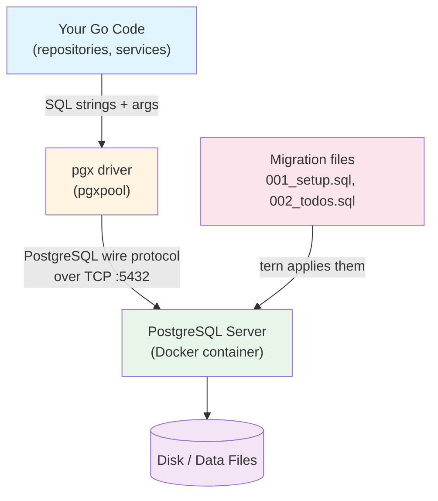

# Database Guide: From Zero to This Project

Welcome! This guide explains **how the database layer of Go-tasker works**, starting from the absolute fundamentals and building up to the exact implementation used in this repository.

If you have ever been confused by terms like *driver*, *DSN*, *connection pool*, *migration*, or *schema*, this is the place to start. Every concept is explained **generally first**, then tied directly to **this project's code**.

---

## Who is this for?

- Developers new to Go, SQL, or PostgreSQL.
- Anyone who wants to understand *why* the database code looks the way it does.
- Contributors who need to add a new table or query.

No prior database knowledge is assumed.

For the larger Go backend learning path, start with [../../apps/backend/docs/README.md](../../apps/backend/docs/README.md). These database chapters complement the folder guides rather than replacing them.

---

## Guide Index

Read them in order — each chapter builds on the previous one.

| # | Chapter | What you will learn |
| :- | :--- | :--- |
| 1 | **[01_fundamentals.md](01_fundamentals.md)** | What a database is, what SQL is, tables, rows, columns, keys, indexes, and constraints. |
| 2 | **[02_postgres_and_pgx.md](02_postgres_and_pgx.md)** | PostgreSQL as a server, the `pgx` driver, connection pooling, and the DSN. |
| 3 | **[03_migrations_with_tern.md](03_migrations_with_tern.md)** | Why migrations exist, how Tern works, up/down scripts, and how this project runs them. |
| 4 | **[04_project_schema_reference.md](04_project_schema_reference.md)** | The actual tables, relationships, helper functions, and limits of the constraints. |
| 5 | **[05_query_lifecycle.md](05_query_lifecycle.md)** | The complete journey of a request from HTTP to SQL and back, with diagrams. |
| 6 | **[06_local_infrastructure_and_data_browsing.md](06_local_infrastructure_and_data_browsing.md)** | Why Postgres and Redis are both used, where they run, where the data lives, and how to browse it with CLIs and GUIs. |

---

## The One-Sentence Summary

> Your Go code uses the **`pgx` driver** to send **SQL** over TCP to a **PostgreSQL server**; the shape of the tables that server holds is defined and evolved by numbered **Tern migration files**.

---

## The Layered Mental Model



Each layer has exactly one job:

| Layer | What it is | In this project |
| :--- | :--- | :--- |
| **Database** | The server that stores data | PostgreSQL 16 in Docker |
| **Language** | How you talk to it | SQL |
| **Driver** | Go library that speaks the protocol | `pgx` / `pgxpool` |
| **Schema** | The structure (tables/columns) | Defined by migrations |
| **Migrations** | Versioned, ordered schema changes | Tern + `.sql` files |
| **Connection** | How Go reaches Postgres | DSN built from `.env` → `localhost:5432` |

---

## Quick Reference: Where Things Live

| Concern | File |
| :--- | :--- |
| Connection pool setup | [apps/backend/internal/database/database.go](../../apps/backend/internal/database/database.go) |
| Migration runner (library) | [apps/backend/internal/database/migrator.go](../../apps/backend/internal/database/migrator.go) |
| Migration SQL files | [apps/backend/internal/database/migrations/](../../apps/backend/internal/database/migrations/) |
| Config / DSN inputs | [apps/backend/internal/config/config.go](../../apps/backend/internal/config/config.go) |
| Environment template | [../../apps/backend/.env.sample](../../apps/backend/.env.sample) |
| Task automation | [apps/backend/Taskfile.yml](../../apps/backend/Taskfile.yml) |
| Domain models | [apps/backend/internal/model/base.go](../../apps/backend/internal/model/base.go) |
| Data access layer | [apps/backend/internal/repository/repositories.go](../../apps/backend/internal/repository/repositories.go) |
| Local containers, volumes, and data browsing | [06_local_infrastructure_and_data_browsing.md](06_local_infrastructure_and_data_browsing.md) |

---

## Prerequisites for Following Along

To run the database locally you need:

- **Docker** (with Docker Desktop / WSL integration enabled)
- **Go 1.24.5 or newer**, as declared in the module
- **Task** (`taskfile.dev`)
- **Tern CLI** - install with `go install github.com/jackc/tern/v2@v2.3.3`

Start the database and cache:

Review [../../apps/backend/docs/local-development.md](../../apps/backend/docs/local-development.md) first: the current Compose configuration is passwordless and publishes ports on all interfaces.

```bash
docker compose up -d
```

Then apply migrations:

```bash
cd apps/backend
task migrations:up tasker_DB_DSN="postgres://postgres@localhost:5432/tasker?sslmode=disable"
```

Ready? Start with **[Chapter 1: Database Fundamentals](01_fundamentals.md)**.
