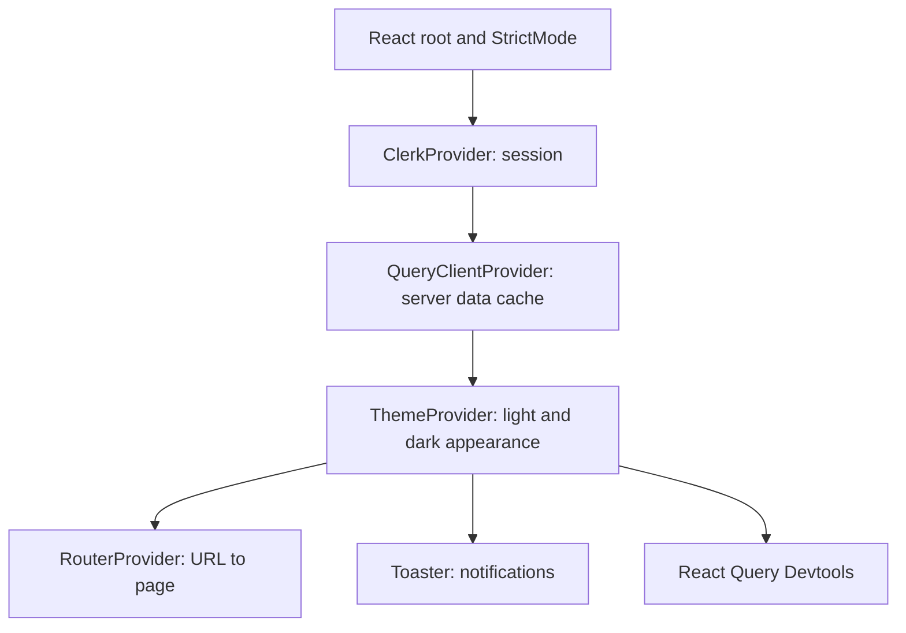

# Frontend: From Browser to API

This is the React client that exists today, not a description of a planned app.
Start with the [project learning guide](../overall_end_to_end/README.md), then
follow the source links below with your editor open.

## 1. The First Render

[main.tsx](../../apps/frontend/src/main.tsx) imports CSS, creates a React root,
and installs providers around the router. A provider makes a value or service
available to components below it without passing it through every prop.



`StrictMode` is a development aid, not an authentication mechanism. Clerk knows
whether the browser is signed in; React Query tracks fetched data; the theme
provider controls appearance. These are three different responsibilities.

There is no longer an `App.tsx` entry component. Read
[router.tsx](../../apps/frontend/src/router.tsx) to see the page composition.

## 2. Routes and Layouts

| URL | Page | Route wrapper |
| --- | --- | --- |
| `/` | Landing | `PublicRoute` |
| `/auth/*` | Authentication layout | `PublicRoute` |
| `/dashboard` | Dashboard | `ProtectedRoute`, `AppLayout` |
| `/todos` | Todo list | `ProtectedRoute`, `AppLayout` |
| `/categories` | Categories | `ProtectedRoute`, `AppLayout` |
| `/settings` | Settings | `ProtectedRoute`, `AppLayout` |

Read [protected-route.tsx](../../apps/frontend/src/components/protected-route.tsx)
and [public-route.tsx](../../apps/frontend/src/components/public-route.tsx).
A browser route guard controls navigation. It does **not** protect the API:
someone can call an HTTP endpoint without opening this UI. The backend must
authenticate requests and check resource ownership separately.

## 3. Where Code Belongs

| Location | Responsibility | Read first |
| --- | --- | --- |
| Pages | Coordinate the screen and its local state | [todos-page.tsx](../../apps/frontend/src/pages/todos-page.tsx) |
| Feature components | Todo/category forms and actions | [todo-create-form.tsx](../../apps/frontend/src/components/todos/todo-create-form.tsx) |
| UI primitives | Reusable buttons, dialogs, inputs | [button.tsx](../../apps/frontend/src/components/ui/button.tsx) |
| Query hooks | Fetching, mutations, cache invalidation | [use-todo-query.ts](../../apps/frontend/src/api/hooks/use-todo-query.ts) |
| API client | URL, token, HTTP transport | [api/index.ts](../../apps/frontend/src/api/index.ts) |
| Contracts | Request/response shapes shared in TypeScript | [todo.ts](../../packages/openapi/src/contracts/todo.ts) |

Do not put SQL in a React component or make a generic button know how to delete
a todo. Each layer should solve a smaller problem than the whole screen.

## 4. HTTP Transport

`useApiClient()` creates a ts-rest client backed by Axios. For each request it:

1. Gets a Clerk token with `getToken()`.
2. Builds the URL as `${env.VITE_API_URL}/api${path}`. Contract paths include
   their version prefix; do not add `/api` again to `VITE_API_URL`.
3. Adds `Authorization: Bearer ...` when a token exists.
4. Sends the method, headers and body through Axios.
5. Returns `{ status, body, headers }` to the calling query or mutation.

The current 401 handling retries up to twice using the **same already-fetched
token**. It is not a token-refresh implementation. Network failures without an
HTTP response are represented as status 500 by this adapter, so inspect the
browser Network panel as well as a displayed error message.

TypeScript contracts help callers use the API correctly. They do not generate
the Go handlers and cannot prove the Go response matches the declared schema.

## 5. Running and Checking

Run workspace commands from the repository root unless a command says otherwise.
The frontend's `dev` script waits for the OpenAPI package's built entry file;
starting only Vite before the shared packages exist can appear to hang.

```bash
bun install
bun run build --filter=@tasker/openapi
cd apps/frontend
bun run dev
```

The configured frontend port is 3000. Its dev script loads a local environment
file using `env-cmd`; never commit real credentials. Browser configuration is
public, even if the file supplying it is ignored by Git.

The current Vite configuration explicitly injects only three values into
`process.env`: `VITE_CLERK_PUBLISHABLE_KEY`, `VITE_API_URL` and `VITE_ENV`.
[env.ts](../../apps/frontend/src/config/env.ts) validates those values with Zod.
Set `VITE_API_URL` explicitly to the backend origin; its current fallback is
port 3000, the frontend port, not the Go API port.

Read the actual [scripts](../../apps/frontend/package.json) before running them:
`build` also installs dependencies, `lint` runs ESLint, and `test` currently says
`vite test`. The presence of that script is not evidence of a configured test suite.

For a real TypeScript check use `bunx tsc -b --pretty false` from the frontend
directory. Plain `tsc` does not traverse this solution config's project
references. Vite bundling and ESLint success are not substitutes for that check.

## 6. Read Actively

1. Follow one click from a page into a feature component and then a mutation hook.
2. Write down the request method, final URL, body and expected status.
3. Find the corresponding Go route and handler.
4. Predict which query keys must be invalidated after success.
5. Use the Network panel to compare your prediction with the real request.

Continue with [state, forms and workflows](state_and_workflows.md), including
cache behavior, attachments, current placeholders and debugging exercises.
