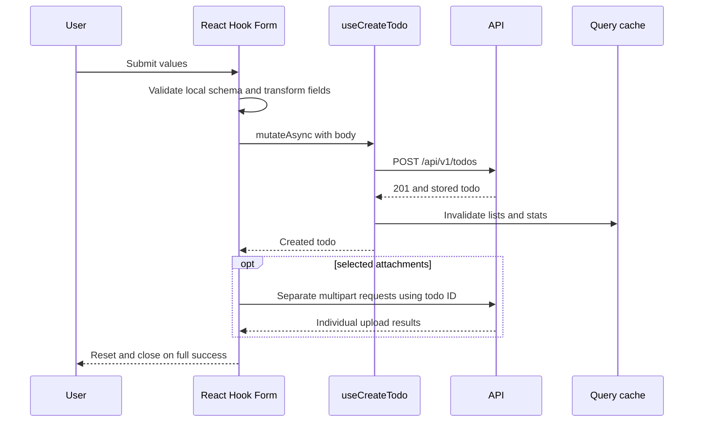

# Frontend State, Forms and Workflows

Start with the [frontend overview](README.md). Keep the linked component and
hook open side by side. The goal is to predict what happens after a click,
then compare that prediction with the Network panel and React Query Devtools.

## 1. Four Kinds of State

| State | Example | Current owner | Lifetime |
| --- | --- | --- | --- |
| Local UI | Search text, current page, open dialog, selected files | `useState` in pages/components | While mounted |
| Form | Values, validation errors, submission | React Hook Form | Form instance |
| Server | Todos, categories, comments, statistics | TanStack Query | Query cache |
| Session/preferences | Signed-in user, theme | Clerk / theme provider | Session / localStorage |

A todo in React Query is a cached copy of backend data. Updating local component
state does not write PostgreSQL. A theme preference in localStorage does not
become a server-side account setting.

Read [main.tsx](../../apps/frontend/src/main.tsx): queries default to a five-minute
`staleTime` and ten-minute `gcTime`. Stale means eligible for refetch, not deleted;
garbage collection applies after queries become unused. Explicit invalidation
can mark data stale before five minutes have elapsed.

## 2. Read a List from the Inside Out

In [todos-page.tsx](../../apps/frontend/src/pages/todos-page.tsx), state holds
status, search, category, priority, sort, selected IDs and page. Search passes
through `useDebounce(searchQuery, 300)`, delaying query changes until typing
settles. The page sends limit 20 and defaults its sort to `updated_at desc`,
which differs from the backend's omitted-sort default of `created_at desc`.

```mermaid
flowchart LR
    Input[User changes filter] --> State[React local state]
    State --> Query[Query object including page and filters]
    Query --> Key[Query key identifies cached result]
    Key --> Hook[useGetAllTodos]
    Hook --> Client[Typed API client and Axios]
    Client --> API[Go API and SQL filters]
    API --> Cache[Result stored in Query cache]
    Cache --> Render[Page renders todo cards]
```

The [hook](../../apps/frontend/src/api/hooks/use-todo-query.ts) uses
`["allTodos", query]` as its key. Page 1 with priority high is a different cached
result from page 2 or priority low. The key is not a URL, table name, or Redis key.

The fetching function checks for HTTP 200 and returns the body; otherwise it
throws the body so React Query sees an error. `placeholderData` supplies an
empty page while real data is unavailable. A placeholder is not evidence that
the server returned zero records. Pages need to distinguish fetching, empty,
error and successful states; the current pages largely render from data and
`isLoading` without a dedicated query-error view.

Changing filters currently does not reset `page` except through `clearFilters`.
When learning pagination, try narrowing results while on page 3 and inspect the
request before concluding matching records do not exist.

## 3. Create a Todo

Read [todo-create-form.tsx](../../apps/frontend/src/components/todos/todo-create-form.tsx).

1. A controlled Dialog stores `open` locally.
2. `useForm` creates field state with defaults, including medium priority.
3. `zodResolver(createTodoSchema)` validates the form's own Zod schema.
4. `form.handleSubmit(onSubmit)` invokes the callback only after form validation.
5. The callback converts `Date` to an ISO string and empty description/category
   strings to undefined, then awaits `createTodo.mutateAsync`.
6. On HTTP 201, the mutation invalidates todo lists and statistics.
7. If files were selected, the form starts separate upload requests with the new
   todo ID and waits for `Promise.all`.
8. Only after the whole form flow succeeds does it reset fields/files, close the
   dialog and show its success notification.

This is not a transaction covering the todo and every file. If an upload fails,
the todo already exists and some uploads may have succeeded. The catch displays
"Failed to create task" even in this partial-success case. Check the list before
retrying creation to avoid duplicates.

The form's 10 MB per-file check is client-side convenience, not a server-enforced
security boundary. The Go storage helper buffers uploads in memory and needs
separate limits. The selection value `none` also deserves attention: the current
create form sends it as a category ID rather than normalizing it away.

## 4. Mutation and Cache Invalidation

Read the [key constants](../../apps/frontend/src/api/query-utils.ts) and hooks.
`invalidateQueries` marks matching cached entries stale and normally refetches
active observers. It does not manually patch SQL or push changes to other users.

| Operation | Cache entries invalidated by current hooks |
| --- | --- |
| Create todo | All todo lists, statistics |
| Update todo | Lists, that todo detail, statistics |
| Delete todo | Lists, statistics |
| Add/update comment | That todo's comment list, detail and todo lists |
| Delete comment | Todo lists, plus detail/comment list if parent was found in cache |
| Upload/delete attachment | Todo detail, attachment key and todo lists |

These hooks generally wait for server success rather than optimistically
editing cached rows. `useDeleteComment.onMutate` looks up the parent todo in the
cache; it does not optimistically remove the comment.

Current keys do not include the authenticated user's ID, and the provider is
created outside the auth routes. Do not infer account-switch isolation from
server authorization alone: cache clearing or identity-scoped keys need review.

## 5. Comments and Attachments

[Comment hooks](../../apps/frontend/src/api/hooks/use-comment-query.ts) read the
list under a todo and mutate individual comments using separate endpoints.
Enabled flags prevent selected detail queries from fetching before an ID exists.

[Attachment hooks](../../apps/frontend/src/api/hooks/use-todo-attachment-query.ts)
build `FormData` and append `file`; multipart is not JSON. Download first requests
`{url}` from the API, then uses a temporary storage URL. The browser never needs
the S3 secret key. Upload and deletion invalidate affected todo representations
because attachments are included in populated todo responses.

The download helper uses `useMutation` even though its HTTP method is GET. Here
that models a user-triggered command, not proof that every mutation hook changes
database data.

## 6. Components and Styling

Feature components compose the [UI primitives](../../apps/frontend/src/components/ui)
with domain behavior. A Dialog handles focus and presentation; a todo form
chooses fields, validates and submits them. Radix supplies interaction primitives,
Tailwind supplies utility styling, and Lucide supplies icons.

[index.css](../../apps/frontend/src/index.css) defines theme tokens and Tailwind
integration. [theme-provider.tsx](../../apps/frontend/src/components/theme-provider.tsx)
stores the choice under `tasker-ui-theme`, then sets the document's light/dark
class. System mode samples `matchMedia` when its effect runs; it does not install
a listener for subsequent OS theme changes.

`children` lets a form wrap a trigger supplied by a page. Props pass values and
callbacks downward; callbacks carry user intent upward. Start by reading one
button and Dialog before trying to understand every UI primitive.

## 7. What Is Implemented Versus Placeholder

| Area | Current source behavior |
| --- | --- |
| Auth route wrappers | Wait for Clerk; signed-out protected visits go to `/`; signed-in public visits go to `/dashboard` |
| Dashboard | Fetches statistics, five recent todos and a category preview |
| Todo page | Search/filter/sort/pagination and individual todo actions |
| Selection | Stores selected IDs; no bulk mutation command is wired |
| Status tab badges | Non-`all` counts are hardcoded zero, not live statistics |
| Categories | List and create/edit/delete forms |
| Settings appearance/profile | Theme switching and Clerk profile display |
| Settings actions | Export/import/delete, account management and privacy buttons lack implemented actions |
| Notifications settings | Placeholder labels; not persisted preferences controlling cron |
| Settings counts | Hardcoded zero values, unlike dashboard API statistics |
| Settings security copy | Not evidence of configured TLS, encryption at rest or a retention system |

Use [settings-page.tsx](../../apps/frontend/src/pages/settings-page.tsx) to verify
the last five rows. UI text is not an implementation guarantee.

## 8. Debugging and Practice

| Symptom | Inspect first |
| --- | --- |
| Changes disappear on reload | Was only local state changed, or did a successful mutation reach the backend? |
| Correct SQL data, stale UI | Mutation invalidation and query keys |
| Blank-looking list | HTTP error, placeholder data, active filters and page number |
| 401 repeated | Token/config pairing; retries reuse the current token |
| Task exists after form error | Later attachment failure, not necessarily failed todo creation |
| Invalid category when selecting none | Form sentinel value versus UUID contract |

Exercises, using disposable records:

1. Write the key for page 2 of high-priority tasks before inspecting Devtools.
2. Explain why the form uses `mutateAsync` before it can upload files.
3. Predict every screen affected by renaming a category, then inspect that hook's
   actual invalidation list. Do they agree?
4. Compare an empty description, omitted description and JSON null across form,
   contract, Go pointer and SQL update. Do not assume they mean the same thing.
5. Rebuild a small filter control yourself, then trace its resulting request.