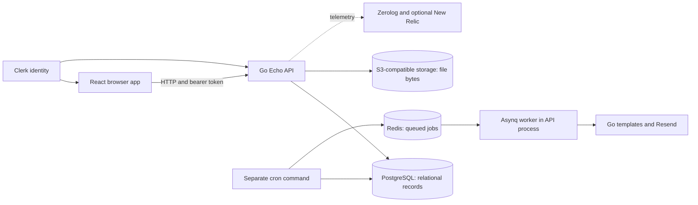

# Tasker: The Complete Learning Path

This guide explains the project currently in this repository: what each part
does, why it is separate, how data moves, and where the implementation is still
incomplete. It is written for learning after following a tutorial or using code
assistance, not for memorizing generated code.

Reviewed against source on **2026-10-25**. This is a source-based explanation,
not proof of passing runtime tests or production readiness. Backend tests and
deployment are still later work. The local reference checkout is not the
application being documented.

## Start Here

If you have 30 minutes, read the architecture, follow todo creation once, then
explain it aloud without looking. Do not start by reading every UI primitive or
logging helper.

| Order | Read | You should be able to explain |
| --- | --- | --- |
| 1 | [Architecture and stack](architecture_and_tech_stack.md) | Processes, dependencies and storage boundaries |
| 2 | [Go reading basics](../../apps/backend/docs/go-reading-basics.md) | Pointers, methods, interfaces, generics and contexts |
| 3 | [Backend reading path](../../apps/backend/docs/README.md) | Startup and each backend layer |
| 4 | [Database chapters](../database/README.md) | Schema, SQL, pgx, migrations and query execution |
| 5 | [Shared packages](../../packages/README.md) | Zod, contracts, build output and email artifacts |
| 6 | [Frontend overview](../frontend/README.md) and [workflows](../frontend/state_and_workflows.md) | Routing, state, forms, transport and caching |
| 7 | [Real request walkthroughs](request_walkthroughs.md) | Create/list/edit/upload and error return paths |
| 8 | [Cron and queued work](../../apps/backend/internal/cron/README.md) | Scheduling versus durable queue consumption |
| 9 | [Feature checklist](how_to_add_features.md) | How to extend one behavior across the needed layers |
| 10 | [Learning workbook](learning_workbook.md) | How to practice, debug and test understanding |

For setup commands, use [local development](../../apps/backend/docs/local-development.md).
For design tradeoffs, read [what the extra layers buy you](how_it_differs_from_todo_app.md).

## The One-Picture Model

Backend layers are packages inside one Go process, not independent microservices.
Models describe values moving between them, not an extra network hop. TypeScript
packages are local dependencies; they do not run Go code.

## Current Feature Inventory

| Area | Implemented in source | Do not assume |
| --- | --- | --- |
| Todos | CRUD, status, priority, dates, root lists, filters, statistics | All combinations of SQL joins or hierarchy updates are tested |
| Categories | List/create/update/delete and owner-scoped uniqueness | A public category-detail GET endpoint exists |
| Comments | Nested list/create and individual update/delete | Foreign keys alone prove owner access |
| Attachments | Multipart upload, metadata, delete, temporary download URL | Storage and database changes are atomic |
| Browser | Auth, dashboard, forms, query hooks, theme and pages | Every displayed control is functional |
| Settings/bulk UI | Some presentation and local selection | Import/export/delete-all, notification preferences or bulk mutations work |
| Background work | Reminder/report queue tasks, cron commands and auto-archive | Jobs are automatically scheduled or emails are sent exactly once |
| Testing | PostgreSQL test helpers | Feature coverage exists; no backend `_test.go` files are present here |
| Deployment | Local infrastructure and runtime code | Hardened deployment, backup/restore and monitoring have been verified |

## How to Read a Layer

Ask the same questions for each function:

1. Who calls it, and when?
2. Which values are trusted, user-supplied or generated?
3. Does it read, write, allocate, enqueue or call an external service?
4. What result does it return, and who consumes it?
5. Which failure can occur here, and what has already happened by then?
6. What focused check would demonstrate correct behavior?

Use the source links beside each explanation. If the code differs after a later
change, update the explanation rather than forcing the code to match old prose.

## Known Boundaries Worth Studying

These are not an exhaustive security audit. The detailed guides explain the
source observations and why they matter:

- Go DTOs and TypeScript contracts are independent; compilation does not prove
  SQL, route, nullability or response agreement.
- Todo populated joins can duplicate nested rows; PATCH lacks explicit presence
  tracking for some nullable fields.
- Uploads and object deletion have partial-failure/cleanup risks.
- Reminder reruns can enqueue duplicates; some UI settings are placeholders.
- The OpenAPI runtime export has a path mismatch; Vite aliases can hide it.
- Plain frontend `tsc` does not check its referenced projects; use `tsc -b`.
- Local Compose uses broadly exposed, passwordless data services. Review network
  and credential settings before running it on a shared network.

No application code, secrets, tests or deployment configuration are changed by
these guides. No generator needs to run merely to read them.

## Your First Session

Read the create-todo walkthrough, locate its form and SQL, then close the guide.
Draw the path from button click to stored row and back. Mark identity, validation,
default values and errors. Reopen the source only to correct your drawing.
Continue with the workbook when you can explain that path in your own words.
