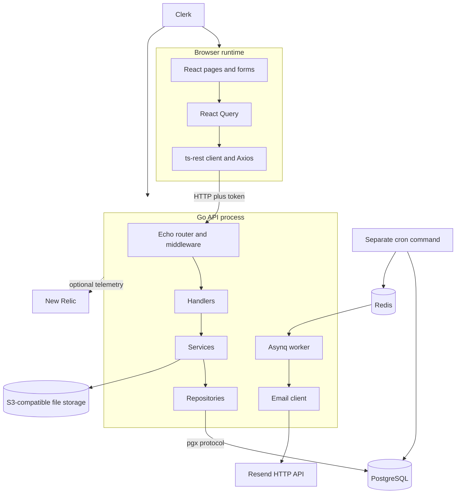

# Architecture and Technology Map

Back to the [learning index](README.md). This chapter separates **runtime
processes**, **code layers**, and **build tools**. Mixing these categories makes
a full-stack repository appear more complicated than it is.

## 1. What Actually Runs?

| Process or service | Responsibility | Local entry |
| --- | --- | --- |
| Browser app | Render pages, collect input, call API | Vite serves port 3000 during development |
| Go API | HTTP routes, rules, SQL, attachment access | `go run ./cmd/tasker` from backend |
| Asynq worker | Process queued emails | Started inside the Go API process |
| Cron executable | Run one periodic job and exit | `go run ./cmd/cron list` shows names |
| PostgreSQL | Store relational records | Compose publishes 5432 |
| Redis | Store Asynq queue data | Compose publishes 6379 |
| Email preview | Preview TSX templates | JS workspace dev server on 3001 |
| External integrations | Clerk, S3-compatible storage, Resend, optional New Relic | Configured clients, not Compose services |

Docker runs the two local data services, not every app in this repository.
Root `bun dev` runs JavaScript workspace scripts; it does not start the Go API.
Cron requires an external scheduler for automatic periodic invocation.

## 2. Why These Technologies?

| Technology | Job here | Why useful | What it does not guarantee |
| --- | --- | --- | --- |
| Go / Echo | Compiled API with HTTP routing and middleware | Explicit functions, types and concurrency | Correct SQL or complete authorization |
| React / Router | Component UI and URL-to-page mapping | Reusable UI and predictable navigation | Server security |
| Vite | Development server and browser bundle | Fast feedback and module bundling | Full TypeScript checking |
| Tailwind / Radix / Lucide | Styling, UI behavior and icons | Consistent reusable controls | Every screen is accessible or complete without verification |
| React Hook Form / Zod resolver | Form state and field validation | Centralized errors and submission | Backend acceptance of every locally valid value |
| TanStack Query | Server-data cache, fetch/mutation lifecycle | Shared fetching and invalidation | Push updates or persisted server data by itself |
| ts-rest / Zod | Typed contract definitions and schemas | Reuse shapes across TS callers | Automatic Go code generation or runtime response agreement |
| PostgreSQL / pgxpool | Relational storage and reusable connections | Constraints, SQL, transactions, pooling | Cross-system atomicity with S3 or Redis |
| Tern | Ordered schema changes | Repeatable migration history | Down migrations that were never written |
| Clerk | Identity and session integration | Avoid custom password/session machinery | Resource ownership policy for this application |
| Redis / Asynq | Queued background work | Retryable work outside browser requests | Exactly-once side effects or automatic schedules |
| AWS SDK / S3 | Binary object storage | Separate large files from relational metadata | Cleanup coordinated with SQL automatically |
| React Email / Go templates / Resend | Author, render and deliver HTML emails | Reusable templates and HTTP delivery | Correct recipient-facing links or inbox delivery |
| Zerolog / New Relic | Structured logs and optional tracing | Correlate requests, errors and timings | Correctness, privacy or availability by configuration alone |
| Testcontainers | Disposable PostgreSQL helper infrastructure | Test real SQL in isolation | Tests exist or cover all behavior |

This project uses PostgreSQL for todos, categories, comments and attachment
metadata. It does not currently store general settings, app configuration or
Clerk users in those tables. Redis is used for jobs, not a demonstrated todo
response cache. The in-process React Query cache is a different cache entirely.

## 3. Startup Is Not a Request

Read [main.go](../../apps/backend/cmd/tasker/main.go):

1. Load case-sensitive `TASKER_` environment configuration.
2. Construct logging and optional New Relic integration.
3. Apply embedded migrations only when `Primary.Env != "local"`.
4. Create the DB pool, Redis client and Asynq worker in `server.New`.
5. Construct repositories, services, handlers and router in that order.
6. Configure timeouts and start HTTP listening.
7. Wait for interrupt, then attempt graceful shutdown with a fresh timeout context.

Constructors store references to shared resources. They do not cause a new pool
for every request. A handler receives a fresh request context and DTO while the
server, repositories and clients continue to be shared.

The [server guide](../../apps/backend/internal/server/README.md) documents exact
shutdown ordering and remaining lifecycle risks. A startup DB ping is not a
feature test or proof that every migration has been applied.

## 4. Layers and Ownership

| Layer | Question it answers | Example |
| --- | --- | --- |
| Router/middleware | Which handler, and may this caller enter? | `/api/v1/todos`, Clerk auth |
| Handler | How does HTTP become an operation? | Bind DTO, get user ID, return 201 |
| DTO/validation | Is input structurally acceptable? | Required title, allowed sort |
| Service | May these records be connected; what happens first? | Check category owner before insertion |
| Repository | Which SQL reads/writes the values? | Parameterized insert and row mapping |
| Database | Which stored invariants hold even under concurrency? | Unique category name per owner |
| Model | What Go shape carries a result? | Todo versus populated Todo |

This is practical layered architecture. Repositories depend on `server.Server`,
services accept `echo.Context`, and some rules remain in repositories. Models
are shared data shapes, not a layer that receives a network request after SQL.

## 5. Build-Time and Runtime Contracts

The [shared package guide](../../packages/README.md) diagrams schema compilation,
OpenAPI generation and email export. None generate Go endpoints. The frontend
and backend meet at HTTP JSON, not at a shared language type system.

Frontend configuration is compiled into client code from explicitly selected
values. It is public. Backend `.env` values configure the Go process and can
include secrets. Ignoring a file in Git does not make values safe if they have
already been logged, pasted or bundled.

## 6. Verify One Boundary at a Time

| Check | Evidence it gives |
| --- | --- |
| Go build/vet | Compilation and selected static problems |
| Frontend `tsc -b` | Referenced TypeScript projects check |
| Vite build | Browser assets can be bundled |
| `/status` | Current implemented dependency probes, with Redis caveat |
| Repository integration test | Particular SQL/constraint/mapping behavior |
| Authenticated browser workflow | Particular UI-to-API behavior |
| Backup/restore or deployment exercise | Particular operational recovery behavior |

These docs were written from source inspection. They do not claim the final
three kinds of verification have been completed. Continue with
[real request walkthroughs](request_walkthroughs.md).
