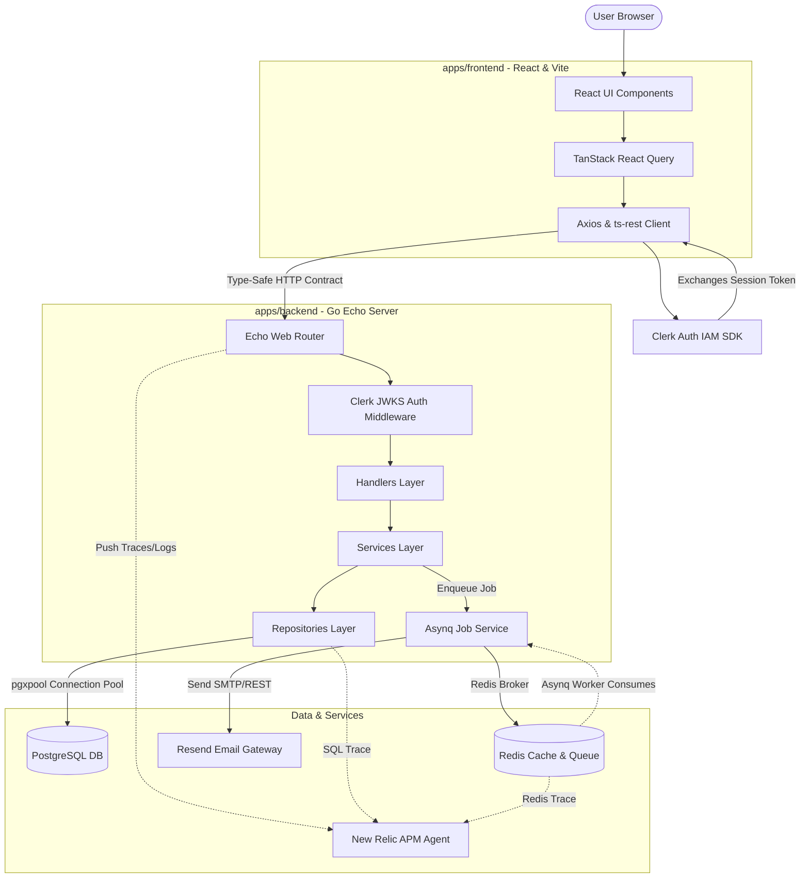

# Enterprise Architecture & Tech Stack

This document describes the modern tech stack utilized in the **Go-tasker** repository, explaining **what** each component is, **why** it is used, **how** everything connects, and **what and where** their responsibilities reside.

---

## 1. High-Level Architecture Flow

When a user interacts with the application, requests and events flow through the system as illustrated below:

---

## 2. Exhaustive Tech Stack Breakdown

### Go & Echo Framework
* **What**: Go (v1.24+) is a statically typed, compiled programming language with excellent concurrency primitives (goroutines and channels). Echo is a minimalist, ultra-fast HTTP router and web framework.
* **Why**: Go provides high performance, minimal memory footprints, and instant cold-starts, making it perfect for cloud-native APIs. Echo compiles in milliseconds, offers robust routing, built-in middewares, and high-convenience error boundary capabilities.
* **Its Job**: Listens for HTTP traffic, parses routes, processes global request/response middleware, and dispatches requests to standard endpoint controllers.

### React 19 & Vite 7 (Frontend)
* **What**: React is the industry-standard UI library for building component-driven interfaces. Vite acts as the build tool and development server, replacing traditional Webpack setups.
* **Why**: React 19 brings outstanding rendering optimization and async state management improvements. Vite offers incredibly fast Hot Module Replacement (HMR) to create an instantaneous feedback loop during development.
* **Its Job**: Renders the complete web application, captures user actions, retrieves data from the API, and enforces UI-level state logic.

### ts-rest & Zod (Contract-First Design)
* **What**: `ts-rest` is an elegant framework for building type-safe, contract-driven APIs. `Zod` is a schema declaration and validation library for TypeScript.
* **Why**: To bypass the classic "frontend got out of sync with response schemas" problem. By having a shared contract package, the frontend and backend are bound to the exact same schema. Any change automatically breaks compilation, making it impossible to accidentally ship incompatible API payloads.
* **Its Job**: The contract file is declared in [packages/openapi/src/contracts/index.ts](packages/openapi/src/contracts/index.ts). High-performance tools parse these schemas to output the [apps/backend/static/openapi.json](apps/backend/static/openapi.json) file and enforce compilation checks in the frontend.

### PostgreSQL & pgx/v5
* **What**: PostgreSQL is an enterprise-grade Relational Database Management System (RDBMS). `pgx` is a pure-Go driver and connection pool implementation for PostgreSQL.
* **Why**: Relational structured databases provide strong ACID guarantees, powerful indexing, and rich relational queries. `pgx` is the fastest, safest, and most idiomatic driver available for Go, with full support for connection pooling and tracer intercepts.
* **Its Job**: Persists all foundational state—such as user settings, transactional business data, and application configurations.

### Database Migrations with Tern
* **What**: Tern is a standalone, light, database-migration tool designed exclusively for PostgreSQL.
* **Why**: Managing database changes via manual SQL executions is error-prone. Tern tracks changes in progressive SQL scripts sequentially.
* **Its Job**: Standardizes migrations using `.sql` scripts inside [apps/backend/internal/database/migrations](apps/backend/internal/database/migrations). When the backend boots, if it is in an environment like staging or production, Tern auto-runs outstanding SQL scripts sequentially to keep the schema strictly up to date.

### Redis & Asynq
* **What**: Redis is an open-source, in-memory key-value data structure store. `Asynq` is a Golang library for concurrent background task processing backed by Redis.
* **Why**: Certain heavy-duty tasks (like sending transactional onboarding emails, generating reports, or hitting external APIs) shouldn't block the user's HTTP request-response cycle. Offloading these to a queue guarantees instant HTTP response times for users.
* **Its Job**:
  * Redis acts as the message broker storing task metadata.
  * `Asynq` runs highly persistent consumer workers that fetch tasks, handle custom retry counts (exponential backoff), route them to matching queues (e.g., `critical` or `default`), and process them safely.

### User Authentication with Clerk
* **What**: A complete User Management and Identity-as-a-Service (IDaaS) platform.
* **Why**: Building secure authentication, reset passwords, session cookies, MFA, and organization-scoped roles from scratch is complex and carries high security risks. Clerk provides pre-built hooks and immediate security compliance.
* **Its Job**: 
  * The frontend uses `@clerk/clerk-react` to display sign-in widgets and fetch unique JSON Web Tokens (JWT).
  * The backend utilizes a JWKS verification middleware in [apps/backend/internal/middleware/auth.go](apps/backend/internal/middleware/auth.go) to validate JWTs cryptographically without executing an external network call on every request, populating custom contextual variables like `user_id` and `user_role`.

### Transactional Emails with Resend
* **What**: An modern transactional email delivery gateway.
* **Why**: High email inbox-deliverability, beautiful analytics, and friendly Go SDKs.
* **Its Job**: Outgoing transactional emails (like welcome prompts) are rendered into a string on the background threads and pushed over HTTP using Resend's API.

### Observability with New Relic APM & Zerolog
* **What**: New Relic is an Application Performance Monitoring (APM) system. `Zerolog` is a superfast, JSON-structured logger for Go.
* **Why**: In production, tracking latency, database query times, Redis round-trips, and trace propagation is crucial. Full APM tracing connects these seamlessly.
* **Its Job**: 
  * Integrations inject timing spans into Echo requests (`nrecho`), database sessions (`nrpgx5`), and Redis interactions (`nrredis`).
  * `Zerolog` formats all standard statements into JSON, enabling structured log forwarders to grep, filter, and trace easily.

### Integration Testing with Testcontainers
* **What**: Testcontainers is an automated testing package that allows spawning actual temporary Docker containers for PostgreSQL and Redis directly from Go tests.
* **Why**: Unit tests with mock databases often fail to catch syntax errors or actual PostgreSQL behaviors. Real integration testing guarantees migrations and queries behave exactly as expected.
* **Its Job**: spins up active Postgres and Redis Docker instances during runtime of [apps/backend/internal/testing](apps/backend/internal/testing) tests, and tears them down cleanly upon completion.

---

## 3. Communication and Data Connection Layout

To keep code decoupled, dependencies are initialized once and passed via **Constructor Dependency Injection** inside [apps/backend/cmd/go-tasker/main.go](apps/backend/cmd/go-tasker/main.go):

1. **Server Boot**: `config.LoadConfig()` parses environment variables.
2. **Database Initiation**: `database.New()` sets up the core PostgreSQL connection pool. New Relic tracers are attached directly to intercept database calls.
3. **Queue Bootstrap**: `job.NewJobService()` initializes the `Asynq` queue client and worker pool connected to Redis.
4. **Clean Layering wire-up**:
   * Repositories are built with access to the database pool.
   * Services are built with access to repositories and the background job service.
   * Handlers are built with access to services.
   * Router loads Handlers and applies authentication/tracing middlewares.

This strict downward dependency chain (Handlers → Services → Repositories) makes sure that business logic, persistence layers, and routing concerns never leak into one another.
