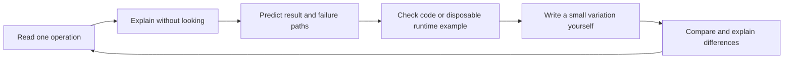

# Learn by Explaining, Predicting and Rebuilding

Back to the [learning index](README.md). This workbook is for moving from
following a tutorial to making decisions yourself. Do one small exercise at a
time; do not try to memorize every file.

## The Loop

For each function, answer six questions: who calls it, what enters, what exits,
what it changes, what can fail, and who handles the failure. Those questions are
more useful than memorizing constructor names.

## Stage 1: Understand the Pieces

Read the [architecture](architecture_and_tech_stack.md), then the
[Go syntax guide](../../apps/backend/docs/go-reading-basics.md).

Exercises:

1. Identify which processes are long-running and which commands run once.
2. Explain the difference between a Go package and a Bun workspace package.
3. Trace a `New...` constructor: which dependencies are shared across requests?
4. Explain `*Todo`, `nil`, `(result, error)`, `%w`, a method receiver, `defer`,
   struct tags, an interface and a generic type using actual source examples.
5. Trace one configuration name through dotenv, Koanf and its consuming field.

Checkpoint: explain why adding a model does not create a table, and adding a
handler does not register an HTTP endpoint.

## Stage 2: Understand One Vertical Feature

Use [Category creation](../../apps/backend/docs/building-a-feature.md) because
its SQL is smaller than populated Todo queries.

On paper, write the request body and distinguish client values, authenticated
values and database-generated values. Then find all three registries and the
route registration. Predict invalid JSON, missing color, duplicate names and
another user's ID before exercising anything against disposable data.

Checkpoint: explain the successful response and each failed path without reading
the whole file aloud. Identify the line that decides behavior, not just a wrapper.

## Stage 3: Understand Data and SQL

Read the [database chapters](../database/README.md).

1. Draw the four tables and foreign-key delete behavior from memory.
2. Explain `NULL` versus an empty string and why PATCH pointers cannot distinguish
   every clear operation.
3. Explain `RETURNING`, named parameters, row collection and ownership filters.
4. Calculate page offsets and total pages for 43 matches at limit 20.
5. Draw the joined rows for two children, three comments and two attachments.
6. Explain why an index is neither a uniqueness rule unless declared unique nor
   a guarantee of a fast query.

Checkpoint: explain what `go build` cannot tell you about SQL and row mapping.

## Stage 4: Understand the Browser

Read the [frontend workflow guide](../frontend/state_and_workflows.md).

1. Classify every state variable in one form/page as UI, form, server or session.
2. Follow a filter into its query key and final URL.
3. Explain why data becomes stale and what invalidation does.
4. Predict which queries should refresh after editing a category or comment.
5. Find a visible button with no callback. Explain why its label is not a feature.
6. Compare the request after selecting no category with the contract's UUID rule.

Checkpoint: use Devtools to distinguish an empty response, placeholder data,
stale data, an unauthorized response and a network failure.

## Stage 5: Write One Small Change Yourself

These are suggested exercises, not already implemented changes:

| Exercise | Layers involved | Completion check |
| --- | --- | --- |
| Reset page when filters change | Frontend state/query | Narrow a search from a later page; request starts at page 1 |
| Replace hardcoded status counts | Query data/page | Counts come from a deliberate stats definition |
| Add a dedicated fetch-error view | Page/query state | API failure is not displayed as an empty dataset |
| Fix no-category normalization | Form/contract | Sentinel string is never sent as a UUID |
| Add a nullable-field clear operation | Contract, DTO, SQL, form | Omit, set and clear have distinct tested meanings |

Choose one. Write acceptance examples before code. Ask for review after your
attempt; do not replace the exercise with a generated whole-feature solution.
Use the [feature checklist](how_to_add_features.md) for cross-layer changes.

## Stage 6: Reliability, Later Testing and Deployment

Study [cron/jobs](../../apps/backend/internal/cron/README.md),
[attachments](../../apps/backend/internal/service/README.md), and
[test isolation](../../apps/backend/internal/testing/README.md).

Write a failure table for: database unavailable, Redis unavailable, invalid
Clerk token, S3 upload successful but SQL failed, and email sent before worker
acknowledgment. For each, state what was persisted and whether retry can duplicate it.

Later tests should cover validation, ownership, SQL cardinality, generated
contracts, multipart uploads, partial failures and cache behavior. Deployment
should address credentials, TLS, network bindings, migrations, backups, health,
graceful shutdown, scheduling and artifact packaging. These are future gates,
not completed achievements because dependencies exist.

## A Debugging Method

1. Reproduce the smallest failing action.
2. Record method, path, status and a redacted payload shape.
3. Find the request ID and corresponding backend logs.
4. State one local hypothesis: for example, "the selected sentinel reaches the
   UUID binder" rather than "the backend is broken".
5. Choose one check that could disprove it.
6. Make one small change, rerun that check, and explain why it fixes the cause.

Do not print entire environment files, use real data for destructive examples,
or repeatedly regenerate unrelated artifacts while investigating a local bug.

## Glossary

| Term | Meaning in this project |
| --- | --- |
| Monorepo | One Git repository containing multiple apps/packages |
| Workspace | A locally linked JavaScript package in Bun's package graph |
| DTO | Input type for an operation, often with binding/validation tags |
| Model | Go representation of a row, populated result or summary |
| Contract | TypeScript description of HTTP methods, paths and shapes |
| Middleware | Wrapper around request handling |
| Dependency injection | Pass needed objects into constructors/functions |
| Serialization | Convert values to JSON or another transferable representation |
| Authentication | Establish who is calling |
| Authorization | Decide what that caller may access or change |
| Migration | Ordered schema change tracked by Tern |
| Pool | Reusable database connections |
| Transaction | Related SQL work committed or rolled back together |
| Invariant | Rule that must remain true, such as owner-scoped uniqueness |
| Idempotency | Repeating an operation has no extra unintended effect |
| Cache invalidation | Mark a stored query result stale so it can refresh |
| Presigned URL | Time-limited authorization to access a storage object |
| Trace | Related timing spans through instrumented work |
| Artifact | Generated output consumed elsewhere, such as HTML or OpenAPI JSON |

## Using Assistance Without Skipping Learning

Useful prompts after an attempt:

- "Ask me five questions about this function; do not answer them yet."
- "Review my explanation against the code and identify one mistaken assumption."
- "Give me a failing example for my implementation, not a replacement implementation."
- "Explain why my change belongs in this layer and what test would disprove it."

Keep a brief personal log of prediction, observation and correction. Understanding
is demonstrated by explaining a new case and writing a small variation, not by
finishing a fixed number of pages.