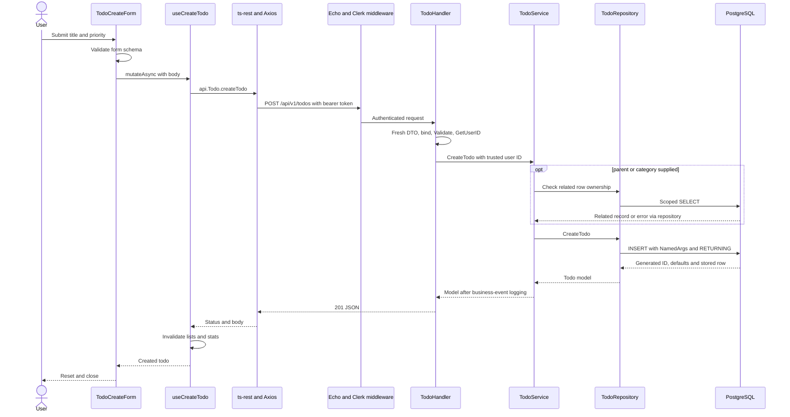
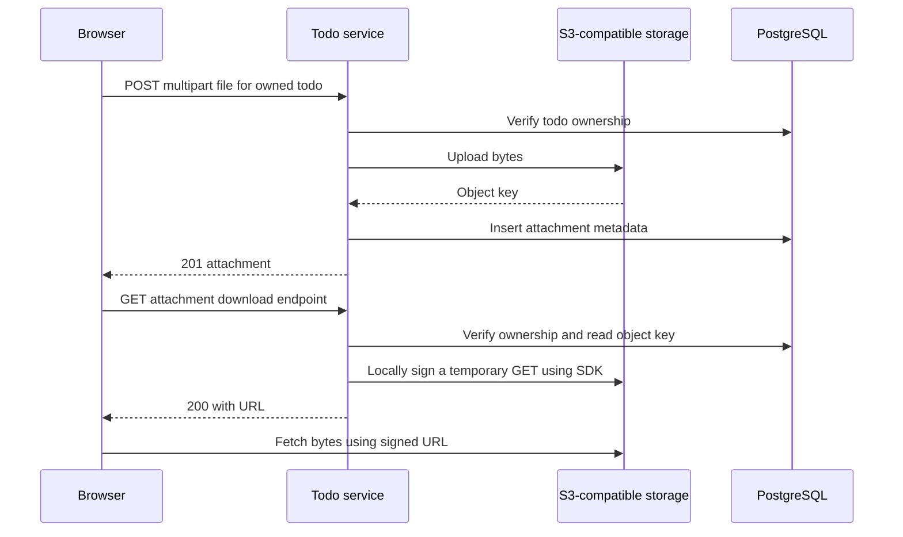

# Follow Real Requests End to End

Back to the [learning index](README.md). These are source walkthroughs, not a
claim that authenticated integration tests have been run. Use your own test
account and disposable records when verifying them. Never paste tokens into docs.

## 1. Create a Todo Without Attachments

Example request body:

```json
{
  "title": "Explain one request without notes",
  "priority": "medium"
}
```

The browser sends `POST /api/v1/todos` to the backend origin with a Clerk bearer
token. This example omits nullable fields and lets the server supply identity,
status and timestamps.



### Which Value Comes from Where?

| Value | Source |
| --- | --- |
| Title, optional priority/category/deadline | Form/request |
| `user_id` | Verified Clerk session subject |
| Default priority if omitted | Repository chooses medium |
| Initial status | Database default draft |
| ID and timestamps | Database defaults |
| HTTP 201 | Handler registration of its response wrapper |
| Visible refreshed list | React Query invalidation/refetch |

### Read These in Order

1. [Form submission](../../apps/frontend/src/components/todos/todo-create-form.tsx)
2. [Mutation and cache](../../apps/frontend/src/api/hooks/use-todo-query.ts)
3. [Transport and token](../../apps/frontend/src/api/index.ts)
4. [Contract](../../packages/openapi/src/contracts/todo.ts)
5. [Route registration](../../apps/backend/internal/router/v1/todo.go)
6. [Authentication](../../apps/backend/internal/middleware/auth.go)
7. [Handler](../../apps/backend/internal/handler/todo.go) and [binding wrapper](../../apps/backend/internal/handler/base.go)
8. [DTO validation](../../apps/backend/internal/model/todo/dto.go)
9. [Service checks](../../apps/backend/internal/service/todo.go)
10. [SQL and mapping](../../apps/backend/internal/repository/todo.go)

An ordinary Go method call crosses each backend layer. Only the browser/API and
database connections in this path cross network boundaries.

## 2. List, Search and Paginate

Example read-only request shape: `GET /api/v1/todos?page=2&limit=20&priority=high`.

The page builds a query object and includes it in its React Query key. The
adapter serializes query values into the URL. Go binds query strings into typed
fields, validates them and fills omitted defaults. `GetTodos` constructs a
condition list beginning with `t.user_id = @user_id`.

Without a parent filter, it adds `t.parent_todo_id IS NULL`, so this is a root
todo list. It counts matching rows separately, adds joins and aggregation,
then orders and applies limit/offset. Page 2 at limit 20 has offset 20.

The response wrapper contains `data`, `page`, `limit`, `total` and `totalPages`.
A page can be empty even when total is nonzero if its offset is beyond the last
record. Count and list are separate SQL statements, not one snapshot transaction.

### A Join Exercise

One todo with two children and three comments yields six joined rows before
aggregation. Add two attachments and there are twelve. The current query can
repeat nested array entries because all relationships are joined together.
This is why a successful single-row example does not prove a populated query
works for realistic cardinalities. See the [repository guide](../../apps/backend/internal/repository/README.md).

## 3. Complete or Edit a Todo

An update uses `PATCH /api/v1/todos/:id` with supplied fields such as
`{"status":"completed"}`. The handler binds the path ID and body into one DTO.
The repository builds only supplied assignments and scopes the update by owner.
Completing sets `completed_at`; changing status to another value clears it.
The database trigger updates `updated_at`.

An omitted field means unchanged. For nullable pointer fields, JSON null also
becomes nil, so it currently cannot reliably mean "clear the database column".
Write that distinction down before adding a clear-date/category button.

## 4. Upload and Download



Presigning ordinarily constructs a URL locally; that diagram step is an SDK
operation, not a required network round trip to the storage service. The URL
expires after 60 minutes in the current helper. The metadata row remains.

Upload/database insertion and database deletion/object deletion are not atomic.
Study the [service failure cases](../../apps/backend/internal/service/README.md)
before treating a success/error toast as the whole storage state.

## 5. An Error's Return Journey

| Failure | Deciding layer | What to inspect |
| --- | --- | --- |
| Missing/invalid session | Auth middleware | 401 response and token/config pairing |
| Missing title | DTO validation | 400 with field errors |
| Invalid related owner | Service-scoped repository lookup | Missing/inaccessible result; no related information disclosure |
| Duplicate category name | SQL unique constraint | SQL error translation, not just form validation |
| SQL syntax or row mapping | Repository/pgx | Wrapped server log, generic client error where appropriate |
| Upload succeeds, metadata insert fails | Service coordinating S3 and SQL | Possible orphaned object |

`%w` keeps the underlying Go error available for `errors.Is`/`errors.As`.
[GlobalErrorHandler](../../apps/backend/internal/middleware/global.go) translates
known SQL/application errors, logs the original failure, and writes JSON only
if the response is not already committed. The client hook checks statuses and
throws unsuccessful bodies; [showApiErrorToast](../../apps/frontend/src/api/utils.ts)
uses a message when present.

Malformed binding and unexpected validation errors have fragile handling in the
current helper. Treat the expected 400 path as something to test, not a claim
that every invalid input is already handled correctly.

## 6. Work That Starts Without a Browser

Read the [cron sequence](../../apps/backend/internal/cron/README.md): a scheduler
invokes the CLI, repositories select work, reminder/report commands enqueue
JSON into Redis, and the worker resolves recipients and sends rendered HTML.
Neither a browser refresh nor a successful todo insert automatically runs cron.

To check understanding, redraw one flow with a failure at every boundary. For
each failure state which side effects already happened and what can safely retry.