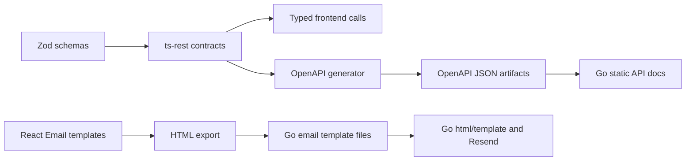

# Shared Packages: Contracts, Schemas and Email Sources

These folders are local Bun workspaces. `workspace:*` means another package in
this repository, not a deployed API or a download from your GitHub repository.

| Package | Purpose | Read next |
| --- | --- | --- |
| `@tasker/zod` | TypeScript data schemas | [Zod guide](zod/README.md) |
| `@tasker/openapi` | ts-rest contracts and OpenAPI generation | [Contract guide](openapi/README.md) |
| `@tasker/emails` | React Email source templates and HTML export | [Email guide](emails/README.md) |

## The Dependency Graph



No arrow here generates Go DTOs, repositories or routes. The Go implementation
is written separately. That boundary is the most important place to check for
drift when adding a field or endpoint.

## Three Different Kinds of Safety

1. **Type checking:** TypeScript catches mismatched shapes in checked source.
   Types disappear from JavaScript at runtime.
2. **Runtime validation:** a Zod schema checks data when code actually invokes
   parsing/validation. Declaring a schema alone does not validate every network
   response. The frontend's Axios adapter does not explicitly parse all responses.
3. **Backend/database protection:** Go DTO validation, authenticated ownership
   checks and SQL constraints protect server-side writes independently of the UI.

The form schema, shared response schema, contract request body and Go DTO are
related but not identical. For example, the form limits a todo title to 255
characters; `ZTodo.title` is a plain string; the Go create DTO independently
enforces 1..255. A TypeScript-valid input may still receive a server 400.

## Source Versus Generated Output

| Edit/read | File or location | How it changes |
| --- | --- | --- |
| Edit | [Zod todo schema](zod/src/todo/index.ts) | Manual schema change |
| Edit | [Todo contract](openapi/src/contracts/todo.ts) | Manual endpoint/shape change |
| Generated build output | Package `dist` directories | `tsc` and `tsc-alias` |
| Generated API docs | [Package JSON artifact](openapi/openapi.json) and [backend copy](../apps/backend/static/openapi.json) | OpenAPI `gen` script |
| Edit | [Email TSX source](emails/src/templates/due-date-reminder.tsx) | Manual template change |
| Generated email artifact | [Backend reminder HTML](../apps/backend/templates/emails/due-date-reminder.html) | Email `export` script |

`bun run build` and OpenAPI `gen` are different operations. The email package
has `export`, not `build`, so a root build does not export email templates.

## Build Order

Root [package.json](../package.json) delegates to Turborepo.
[turbo.json](../turbo.json) makes `build` depend on dependency-package builds
through `^build`. Build Zod before OpenAPI before checking the frontend.

```bash
# Repository root: build OpenAPI and its workspace dependency
bun install
bun run build --filter=@tasker/openapi

# Generate both API documentation artifacts
bun run --cwd packages/openapi gen

# Export email HTML; review the changed artifacts afterward
bun run --cwd packages/emails export
```

Run generators deliberately: they write files. These documentation changes do
not execute them or certify their output. Root `dev` starts JS workspace
watchers and the email preview, not the Go API or Docker services.

## Keep a Change Aligned

For one new field, compare: migration column, Go row model, Go input DTO,
repository SQL, service rule, handler response, Zod schema, contract body,
frontend form/payload and generated docs. Not every change needs every file,
but each boundary needs a deliberate decision.

Continue with the [whole-project learning guide](../docs/overall_end_to_end/README.md).