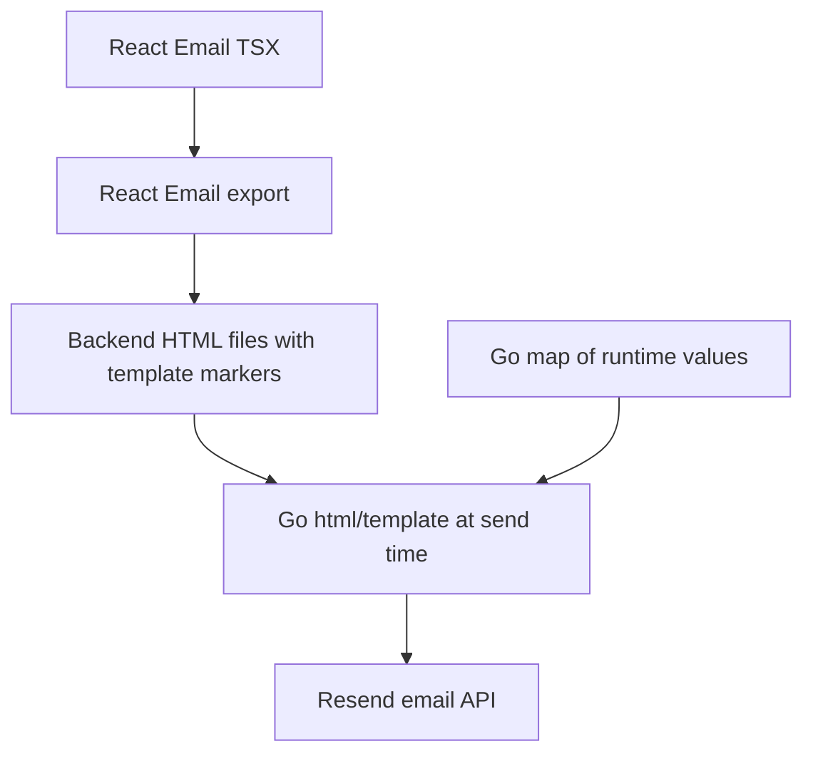

# Emails: React Source, HTML Artifact, Go Delivery

Back to [shared packages](../README.md). For runtime delivery read the
[backend library guide](../../apps/backend/internal/lib/README.md).

This package is not the frontend UI. React Email is used as a template authoring
tool for welcome, due-date reminder, overdue notification and weekly report HTML.



## Two Times, Two Languages

In [due-date-reminder.tsx](src/templates/due-date-reminder.tsx), defaults such as
`"{{.TodoTitle}}"` are intended to survive export as Go template markers. Later,
[emails.go](../../apps/backend/internal/lib/email/emails.go) builds a map with
`TodoTitle`, `TodoID`, `DueDate` and `DaysUntilDue` for Go's template engine.

JavaScript expressions run during React export/preview. Go template actions run
when Go renders the exported HTML. A JavaScript branch involving
`parseInt("{{.DaysUntilDue}}")` cannot inspect the future recipient's number.
Check dynamic branching in exported artifacts; Go does not rerun that JavaScript.

## Commands

From the repository root:

```bash
bun run --cwd packages/emails dev
```

This starts the template preview on port 3001; it is not sending mail.
To deliberately regenerate the backend HTML files:

```bash
bun run --cwd packages/emails export
```

Review both source and artifacts. The backend reads relative HTML paths from
disk at runtime. Unlike SQL migrations, those templates are not embedded into
the binary by the migration package's `go:embed` directive.

## Current Limitations

Templates still contain example branding, localhost image references and
relative links. A recipient's email client needs publicly reachable assets and
absolute application URLs. The `/settings/notifications` link and todo query
actions in templates are not proof of matching router/page behavior. Settings
notification controls are placeholders, and the todo page does not consume those
email action query parameters.

The runtime sender is the sample Resend onboarding address. Verify sender/domain
permissions, HTML escaping, actual template values and recipient routing before
using real outbound mail. A task enqueue success is not proof of delivery.

## Practice

Trace `TodoTitle` from a database row to the queued JSON, Go map and final HTML.
Then explain where an HTML layout change, a subject change and a delivery retry
policy each belong. They are three separate code changes.