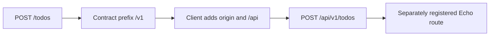

# OpenAPI: Endpoint Contracts and Documentation

Back to [shared packages](../README.md).

## Files to Read

| File | Role |
| --- | --- |
| [contracts/index.ts](src/contracts/index.ts) | Combines Health, Todo, Comment and Category contracts |
| [contracts/todo.ts](src/contracts/todo.ts) | Methods, relative paths, queries, request bodies and response statuses |
| [utils.ts](src/utils.ts) | Bearer/service-token documentation metadata |
| [index.ts](src/index.ts) | OpenAPI generation settings, server URL and security schemes |
| [gen.ts](src/gen.ts) | Serializes the document and writes two JSON artifacts |
| [package.json](package.json) | Build/gen scripts and package exports |

## Follow One URL

Todo creation declares POST `/todos` in a router with `pathPrefix: "/v1"`.
The frontend adapter prefixes its backend origin and `/api`. The result is
`POST http://localhost:8080/api/v1/todos` with the normal local API origin.



The contract's 201 response is `ZTodo`; deletion uses 204 and `z.void()`.
The frontend checks these statuses explicitly. Declaring a status does not
cause Go to return it; the handler chooses its actual status.

Security metadata describes API docs. It does not run Clerk or enforce the
documented service-token scheme. Only middleware attached to Go routes enforces
request authentication.

## Generation Is Separate From Compilation

From the repository root:

```bash
bun run build --filter=@tasker/openapi
bun run --cwd packages/openapi gen
```

The generator writes [openapi.json](openapi.json) and
[the backend static copy](../../apps/backend/static/openapi.json). It converts
the custom file marker to OpenAPI binary form using a serialization-sensitive
replacement. Review the multipart schema after changing upload contracts.
The Go `/docs` UI reads the static artifact; it does not dynamically inspect routes.

## Current Boundaries

- The runtime `./contracts` export points to `dist/contract/index.js` (singular)
  while types point to `dist/contracts/index.d.ts` (plural). This is an existing
  package-export mismatch, not corrected by this documentation.
- Vite aliases `@tasker/openapi` to source, so browser builds can bypass a broken
  built-package export. Verify package consumption separately when fixing it.
- Health declares `/status` without `/v1`; the shared API adapter and documented
  `/api` server base would turn that into `/api/status`. Go registers `/status`.
- Request fields/limits, null handling and error responses can drift from Go.
  The contract is not a generated backend or a complete runtime contract test.

## Practice

For one endpoint, write its method, final URL, path parameters, query, body,
success status and response shape. Locate each choice on the Go side and explain
which fields are optional, nullable or server-generated.