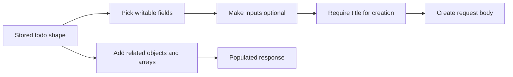

# Zod: Shared Data Shapes

Back to [shared packages](../README.md).

Read [src/index.ts](src/index.ts), [todo/index.ts](src/todo/index.ts),
[category/index.ts](src/category/index.ts), [comment/index.ts](src/comment/index.ts)
and [utils.ts](src/utils.ts). These are response/data schemas used to compose
contracts, not automatically generated Go models.

## Read the Operators

| Expression | Meaning |
| --- | --- |
| `z.string()` | String value; no minimum length unless specified |
| `z.enum([...])` | One of the listed string values |
| `.nullable()` | Also permits JSON null |
| `.optional()` | Also permits undefined or an absent property |
| `.pick({...})` | Select a subset of an object's fields |
| `.partial()` | Make selected fields optional |
| `.required({...})` | Require selected fields again |
| `.extend({...})` | Add fields to an object schema |
| `z.infer<typeof schema>` | Derive a compile-time TypeScript type |

`ZTodo` represents a stored todo. `ZPopulatedTodo` extends it with a nullable
category and arrays of children, comments and attachments. `ZTodoStats` is a
summary shape, not another table. `schemaWithPagination` wraps rows with counts
and page information.

## Dates and Missing Values

The API serializes dates as strings; it does not send JavaScript `Date` objects.
The form converts a Date using `toISOString()`. Go decodes a timestamp into
`time.Time`, and PostgreSQL stores `TIMESTAMPTZ`. A selected local date can cross
a UTC day boundary when serialized, so inspect both instant and display zone.

Many Zod fields are nullable but not optional in responses. Go nil pointers map
to null, while nil slices may encode as null even where a schema expects an
array. Keep actual serialization and declared response shapes aligned.

The metadata schema allows optional values where Go pointer fields can serialize
as null. Do not assume strict response parsing would succeed without comparing
these cases. The current client does not explicitly parse every response.

## Practice

Explain why `z.string().nullable()` accepts null but not an omitted required
property. Then compare the todo create contract's `pick/partial/required` chain
with `CreateTodoPayload` in Go. Find a validation rule present in only one.